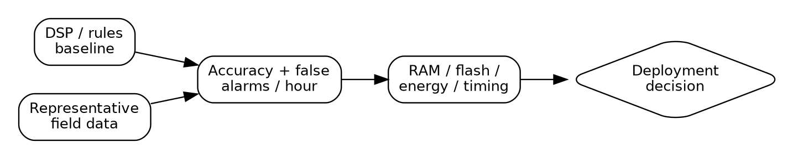
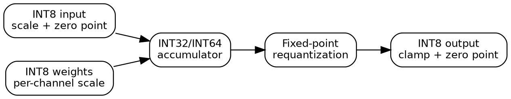
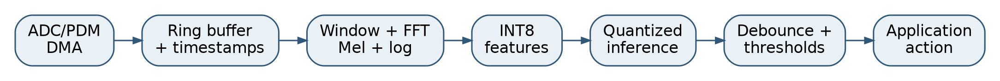
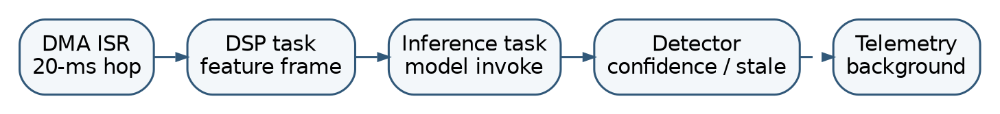
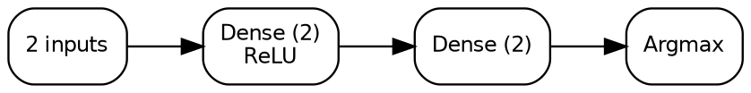
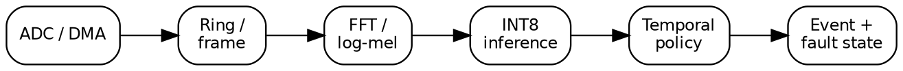

# Preface {-}

This book is for a practicing embedded software engineer who already knows C or C++, interrupts, memory maps, and how to debug a board, but who has not necessarily built a neural-network inference engine. It is *not* a survey of cloud AI. Its central question is: **what must an engineer understand to place a useful, auditable, bounded-latency learned function inside a microcontroller product?**

The emphasis is on Arm Cortex-M devices, in particular integer inference, deterministic memory allocation, real-time integration, DSP preprocessing, and proof by measurement. The numerical methods are portable to other MCU families. Training normally takes place on a development computer; the deployed firmware owns preprocessing, model storage, inference, decision logic, faults, and telemetry.

An original reference kernel is valuable pedagogically even when an optimized production library ultimately replaces it. We will first derive the arithmetic, specify tensor layouts and lifetimes, and write the simplest correct operator. Only then will we discuss optimized backends such as CMSIS-NN. Several case studies refer to the author's public projects, [KWSKit](https://github.com/NetKit-Labs/kwskit), [NetKit](https://github.com/NetKit-Labs/netkit), and [MemKit](https://github.com/NetKit-Labs/memkit). Those projects are independent implementations; the small code snippets in this book are explanatory examples, not drop-in copies of their internals.

**Evidence conventions.** Equations and illustrative calculations are distinguished from measured device observations. Any observed numbers are attributed to a specified repository's recorded test session. A benchmark from one build is never called a worst-case execution-time guarantee, and an offline training accuracy is never called deployed field accuracy. The manuscript is a technical draft, not a safety certification or validated product design.

**Reading path.** Chapters 1--3 establish requirements, mathematical semantics, and quantization. Chapters 4--5 address an original integer runtime and static memory planning. Chapters 6--8 cover audio DSP, system scheduling, and performance optimization. Chapters 9--10 explain the training-to-firmware workflow and complete system design. Chapters 11--13 address verification, a tested integer implementation, and board integration. Chapter 14 provides a reproducible end-to-end classifier; Chapter 15 discusses measured portfolio case studies and the limits of the evidence. Appendices provide a bring-up checklist, glossary, and a compact design worksheet.

**Notation.** Unless qualified, tensor indices are zero-based, convolution is cross-correlation as implemented in contemporary ML libraries, and an INT8 inference tensor uses signed integers in $[-128,127]$. 'Latency' refers to elapsed wall-clock execution time; 'cycles' refers to counted core cycles, which must be qualified by the clock and measurement boundary.

\newpage

# TinyML: An Engineering Manager's Briefing


{width=4.45in}

## The product decision, not the buzzword

TinyML means deploying a learned function in a microcontroller's ordinary firmware execution environment. It is worth evaluating when rules, thresholds, and conventional estimators are not sufficiently robust across real operating conditions, and when a representative labeled data set can be collected and maintained. A neural network does not remove the need for requirements, observability, reliability, or configuration management: it adds a second controlled artifact, the model, to the software product.

A manager should ask for **three alternatives** before funding a TinyML implementation: a classical DSP/threshold baseline; a compact feature-based statistical model; and the proposed neural network. Compare all three against the same operating envelope and held-out data, using false alarms per operating hour, missed events, energy, RAM, flash, full-system latency, and maintenance cost rather than classification accuracy alone.

## Engineering scope and staffing

The embedded team owns sensor acquisition, timing, memory layout, model compatibility, fault behavior, firmware updates, and post-deployment measurement. Data/model specialists, whether internal or external, own dataset quality, training, and statistical evaluation. The handoff is a *versioned executable contract*: sampling rate, preprocessing coefficients, tensor layout, quantization parameters, model hash, operator set, acceptance vectors, and permissible input domain.

A useful first deliverable is not a demonstration video. It is a four-page feasibility record: model-versus-baseline accuracy by operating subgroup; measured on-target CPU/energy budgets; memory map and stack/arena high-water marks; and a test report for stale/corrupt/missing input behavior. Only after those gates should integration complexity increase.

## Typical failure modes

- **Dataset shortcut learning:** the model learns microphone, machine, or recording-session identity instead of the intended signal.
- **Train/deploy skew:** windowing, log base, integer scaling, or sensor gain differs between Python and firmware.
- **Unbounded background load:** profiling covers a standalone kernel but not DMA, interrupts, queues, and telemetry.
- **Unsafe confidence semantics:** an argmax label is treated as permission to actuate; stale outputs are not rejected.
- **Undocumented retraining dependencies:** a preprocessing or sensor revision silently invalidates the model.

## Decision gate

Approve the architecture only when a documented baseline underperforms, an evaluation set represents foreseeable deployment conditions, MCU memory/latency margins are measured, and ownership of model updates is assigned. Reject or defer it if none of these conditions can be established. For safety-relevant actions, the learned classifier should normally inform a separately verified deterministic safety policy rather than act as the sole authority.

**For an interview discussion:** the most interesting engineering question is rarely "Can this MCU run a neural network?" It is "Can this product justify a learned function and operate it predictably for years?"

# The Engineering Case for TinyML

## A learned function is still embedded software

A product need not recognize a thousand object classes for machine learning to be useful. Consider a remote vibration monitor that must identify an abnormal operating pattern, a wake-word interface that must listen without an Internet connection, or a current-sensing controller that must classify operating conditions. In each case the computational problem is local, the inputs arrive continuously, and a decision must meet the same resource, timing, power, safety, and test requirements as the rest of the firmware.

The deployed function may be expressed as

$$y_k = f_{\theta}(\phi(x_{k-L+1:k})),$$

where $x$ is a physical measurement stream, $\phi$ is deterministic preprocessing, $\theta$ is a fixed set of learned parameters, and $f_\theta$ is an inference graph. The firmware also needs postprocessing and a stateful decision policy:

$$a_k = g(y_k,a_{k-1},t_k,\mathcal{F}_k),$$

where $\mathcal{F}_k$ includes sensor validity, dropped data, freshness, and system faults. The action $a_k$ is the product behavior. It is *not* simply the network's largest probability.

A classifier is therefore only one stage of an embedded signal chain:

> Sensor → acquisition → buffering → preprocessing → inference → confidence/temporal policy → actuator or event.

This boundary matters organizationally. The model developer may produce $\theta$, but the firmware team must integrate and verify the *entire* chain. The pipeline must be debuggable with no connection to the training environment.

## When a neural network is preferable

Start with the classical alternative. Many embedded problems admit a hand-designed estimator, filter, threshold, or state machine. A learned model is justified when the input-output relationship is difficult to express economically as explicit rules and a representative labeled dataset exists. It is not justified merely because it can be made to run on the MCU.

Compare candidates using a design objective, not an accuracy-only metric:

$$J = w_e E_{\rm error} + w_t T_{\rm inference} + w_r R_{\rm RAM}
       + w_f F_{\rm flash} + w_p P_{\rm energy} + w_m M_{\rm maintenance}.$$

The weights encode product priorities, and a hard constraint cannot be traded away with a good average score. If $T_{\rm deadline}=10\,\mathrm{ms}$, an algorithm taking $12\,\mathrm{ms}$ is inadmissible even if it has excellent recognition accuracy. Similarly, a speech classifier with a 5% false-trigger rate may be unusable no matter how small its model is.

**Example: a bearing-health monitor.** Compare (A) RMS and kurtosis thresholds, (B) a small feature-based classifier, and (C) a compact convolutional network on a spectrogram. The correct comparison is made against the same dataset split, load/speed operating range, false-positive requirement, and sensor mounting variation. Option A may win if fault modes separate cleanly. Option B may preserve interpretability and use less compute. Option C may generalize to more complex signatures but requires lifecycle management of data and weights.

**When not to use TinyML:** deterministic calibration transforms; small finite-state logic; tasks requiring hard analytical guarantees that the network cannot supply; products without representative deployment data; or systems where updates, traceability, and testing costs exceed the added functionality.

## Why the MCU is a distinctive target

A microcontroller typically executes code from flash, has a bounded on-chip SRAM budget, provides timer/interrupt peripherals, and may have no operating system or only a small RTOS. Contrast this with an application processor whose caches, virtual memory, filesystem, and large DRAM make quite different architectural compromises possible.

The MCU introduces four coupled constraints:

1. **Persistent storage:** weights, graph metadata, lookup tables, and firmware occupy flash.
2. **Working storage:** feature windows, activations, scratch buffers, stacks, DMA rings, and RTOS objects compete for SRAM.
3. **Time:** a chain of operators must complete before the next meaningful decision or buffer deadline.
4. **Energy and heat:** average and peak current matter, especially in duty-cycled systems.

The important conceptual shift is to budget the *complete* firmware image, not a standalone neural-network model. A nominal 40 KiB arena is not a 40 KiB application: it exists alongside audio buffers, call stacks, drivers, diagnostics, and other real-time tasks.

## Four feasibility calculations

### Arithmetic budget

For a fully connected layer with $m$ inputs and $n$ outputs, the nominal multiply-accumulate count is $mn$. An MCU executing an effective $C$ MAC/s would require approximately

$$T \approx \frac{mn}{C}+T_{\rm dispatch}+T_{\rm memory},$$

which is a starting estimate, not a measurement: memory layout, instruction selection, saturation, and cache/bus behavior affect $C$. A complete convolutional network must be evaluated layer by layer rather than extrapolating from a single operator.

### Storage budget

For a graph with weights $W_i$, metadata $M$, non-persistent activations $A$, persistent runtime state $P$, application buffers $B$, and stacks $S$,

$$F_{\rm required} \gtrsim F_{\rm application}+\sum_i |W_i|+M,$$

$$R_{\rm required} \gtrsim A+P+B+S+R_{\rm drivers}+R_{\rm margin}.$$

The activation term should reflect lifetime-based reuse, not a naive sum of all intermediate tensors; Chapter 5 derives this precisely.

### Sampling versus decision rate

For microphone sampling at $f_s=16\,000\,\mathrm{Hz}$, an audio hop of $H=256$ samples arrives every

$$T_H=H/f_s = 16\,\mathrm{ms}.$$

An inference that takes $55\,\mathrm{ms}$ cannot run on every 16-ms hop on the same core without a strategy for decimation, pipelining, overlap, or backlog. But it *may* run every eight hops ($128$ ms) if acquisition can preempt processing and the end-to-end budget holds. The high-priority producer must not be blocked by the consumer.

### Latency budget

For a windowed detector, the total response has more than one component:

$$T_{\rm response}=T_{\rm observation}+T_{\rm queuing}+T_{\rm preprocess}
+T_{\rm infer}+T_{\rm decision}+T_{\rm actuation}.$$

Increasing model speed cannot reduce the observation window. A nearly one-second context window may dominate the first decision after startup even if inference is fast.

## A real Cortex-M case study: continuous keyword spotting

The author's open-source KWSKit repository describes a Zephyr application on an nRF52840 Cortex-M4F at 64 MHz, with 16-kHz audio, CMSIS-DSP log-mel features, and an INT8 inference model. The recorded Zephyr session reports an average inference time of about 54.994 ms, 65,536 bytes of reserved arena with 12,500 bytes reported used, and an 8,192-sample audio ring whose recorded high-water mark was 768 samples. These are *specific test observations* from that repository, not generalized performance claims or WCET bounds [KWSKit, 2026].

This case illustrates a broader engineering pattern: sensor acquisition has higher urgency than occasional inference, a fixed ring decouples production and consumption, and detection events carry timestamps so a late result cannot blindly trigger action. The details are revisited in Chapters 6, 7, and 10.

## Chapter design review

Before selecting an MCU inference architecture, write down: the false-positive/false-negative costs; operating-domain coverage of the dataset; sample and decision periods; maximum accepted time-to-action; worst-case resource ceilings; OTA/model-upgrade policy; safe behavior on invalid or stale data; and the non-neural baseline. A proposed TinyML design without these items remains a demonstration, not an embedded product architecture.

**Exercises**

1. For $f_s=16$ kHz and $H=160$, calculate the hop period. Can a 38-ms inference run each hop on a single non-overlapping worker?
2. Given 128 KiB SRAM, reserve 24 KiB for stacks/RTOS, 16 KiB for DMA/audio, and 8 KiB margin. What is the maximum combined activation plus persistent model allocation?
3. Propose a classical alternative to a neural wake-word classifier, including the experiment needed to compare them fairly.

# Mathematics of Inference on an MCU

## The inference graph as a composition

A trained model is a parameterized, deterministic function composed of tensor operators. For a feedforward graph with layers $F_1,\dots,F_L$, evaluation is

$$a^{(0)}=x,\qquad a^{(\ell)}=F_\ell(a^{(\ell-1)};\theta_\ell),\qquad y=a^{(L)}.$$

For inference, $\theta_\ell$ is fixed. There is no gradient calculation, optimizer state, or training dataset resident in firmware. Unlike training, the primary computational problems are: implement $F_\ell$ correctly, schedule buffer lifetimes, minimize expensive transfers, and preserve numerical behavior through quantization.

A tensor is more than a pointer. At minimum it has an element type, rank, dimensions, stride order, layout, quantization metadata, and an ownership/lifetime contract. A tensor $X\in\mathbb{R}^{N\times H\times W\times C}$ in NHWC order typically stores its elements at

$$\operatorname{addr}(n,h,w,c)=\operatorname{base}+
[((nH+h)W+w)C+c]\cdot b,$$

where $b$ is bytes per element. NCHW is equally valid but differs in locality and therefore affects kernel design. A silent layout mismatch often produces plausible-looking yet incorrect outputs.

## Affine layers and nonlinearities

The elementary dense layer is

$$z_j=b_j+\sum_{i=0}^{m-1}W_{ji}x_i, \qquad a_j=\phi(z_j).$$

The cost is $mn$ MAC operations, $mn$ weights, $n$ biases, and (without in-place tricks) $m+n$ activation values. A ReLU activation is $\phi(z)=\max(z,0)$; ReLU6 clips to $[0,6]$. An activation can be fused with its producer, avoiding a separate memory pass.

For a piecewise-linear network, a great deal of the apparent mathematical sophistication reduces to repeated integer dot products, clipping, and carefully specified rescaling. The difficulty is not the abstract formula but exact integer ranges, tensor indexing, and performance under constrained memory.

### Worked example: a two-output layer

Let

$$W=\begin{bmatrix}1&-2&1\\-1&1&2\end{bmatrix},\qquad
x=\begin{bmatrix}2\\3\\-1\end{bmatrix},\qquad
b=\begin{bmatrix}1\\-2\end{bmatrix}.$$

Then $Wx+b=(-4,\,-3)^T$ and applying ReLU yields $(0,0)^T$. The example is intentionally small enough to calculate by hand; it should become a reference test before optimized kernels are introduced. In a deployed integer network, the operands and output may have different scales, so Chapter 3 adds the requantization step.

## Two-dimensional convolution

In machine-learning libraries, the operator usually called *convolution* is spatial cross-correlation: the kernel is not reversed. For NHWC input $X$, weights $K\in\mathbb{R}^{K_h\times K_w\times C_{\rm in}\times C_{\rm out}}$, output $Y$, padding $(P_h,P_w)$ and stride $(S_h,S_w)$,

$$Y[n,h,w,o]=b_o+\sum_{r=0}^{K_h-1}\sum_{s=0}^{K_w-1}
\sum_{c=0}^{C_{\rm in}-1}X[n,hS_h+r-P_h,wS_w+s-P_w,c]K[r,s,c,o],$$

with out-of-range $X$ treated as zero in real-number semantics. The output dimensions, for dilation $D=1$, are

$$H_{\rm out}=\left\lfloor\frac{H+2P_h-K_h}{S_h}\right\rfloor+1,\qquad
W_{\rm out}=\left\lfloor\frac{W+2P_w-K_w}{S_w}\right\rfloor+1.$$

In a quantized implementation, *real zero* is represented by the input tensor's zero point, not necessarily by integer 0. Padding with literal integer zero in an asymmetric tensor is a correctness bug.

The approximate MAC count is

$$N H_{\rm out}W_{\rm out}C_{\rm out}K_hK_wC_{\rm in}.$$

For illustration, a $1\times16\times16\times8$ feature tensor convolved with $3\times3$ kernels to 16 output channels at stride one and 'same' padding requires $16\cdot16\cdot16\cdot3\cdot3\cdot8=294{,}912$ MACs; the output has $4{,}096$ values. An INT8 output occupies 4 KiB; an FP32 output occupies 16 KiB. Those bytes matter as much as the MAC count.

## Depthwise and pointwise factorization

A conventional convolution jointly mixes spatial neighborhoods and input channels. A depthwise convolution applies one $K_h\times K_w$ spatial filter to each input channel (or a small multiplier per channel). A pointwise $1\times1$ convolution then mixes channels.

For $C_{\rm in}=C$, $C_{\rm out}=O$, output area $HW$, kernel size $K=K_hK_w$:

$$\operatorname{MAC}_{\rm standard}=HWKCO,$$

$$\operatorname{MAC}_{\rm depthwise+pointwise}=HW(KC+CO).$$

Their ratio is

$$\rho=\frac{KC+CO}{KCO}=\frac{1}{O}+\frac{1}{K}.$$

With $K=9$ and $O=32$, $\rho\approx0.142$. This is a 7-fold reduction in nominal MAC count, **not** a promise of a 7-fold speedup. Overheads, scratch buffers, cache locality, and support for each operator can alter the outcome. Tiny models with very narrow channels may not amortize optimized-kernel setup costs.

## Pooling, reduction, and classification

Average pooling over a region $\Omega$ is

$$y_c=\frac{1}{|\Omega|}\sum_{(h,w)\in\Omega}x_{h,w,c}.$$

The division and rounding policy must be specified for integer arithmetic. Maximum pooling selects the largest value; if input and output quantization are identical, comparisons can remain entirely in the integer domain.

For logits $z_i$, softmax is

$$p_i=\frac{\exp(z_i-m)}{\sum_j\exp(z_j-m)},\qquad m=\max_j z_j.$$

Subtracting $m$ improves numerical stability. For simple argmax classification, softmax is unnecessary because $\arg\max_i z_i=\arg\max_i p_i$. But if the downstream detection logic uses calibrated confidence thresholds, dropping softmax without revisiting the policy changes system semantics.

## Parameter counting and model metadata

A model with $n$ INT8 weights has $n$ bytes of raw weight values. But the binary artifact includes bias arrays (often INT32), tensor shapes, offsets and scales, operator definitions, scheduling metadata, and serialization overhead. The flash cost can exceed the parameter payload by a large factor for tiny graphs.

Example: a dense layer with $128$ inputs and $16$ outputs has $2048$ INT8 weight bytes and $64$ bytes of INT32 bias. That is $2112$ bytes of parameter payload, excluding alignment and metadata. A layer with $5{,}000$ parameters need not produce a $5{,}000$-byte model file.

## Graph structure determines buffer reuse

A chain $A\to B\to C$ allows the storage of $A$ to be reused when $B$ has consumed it. A skip connection $A\to B\to C$ with $A$ also used by $C$ lengthens $A$'s lifetime. The minimum peak activation memory is thus a graph-liveness problem, not a simple sum of model dimensions. Treating all model tensors as simultaneously live can grossly over-allocate; treating them as sequential without analyzing fan-out can corrupt live values.

## Precision is part of correctness

A floating-point reference normally defines the conceptual graph. Integer inference approximates it, but the reference that matters for regression tests is the *specified quantized graph*, including signed ranges, zero points, rounding, accumulation and clamping. Two mathematically reasonable requantization routines may differ by one output least-significant bit. That discrepancy can be important near a threshold or on a long sequence of operators.

For testing, separate three assertions: (1) structural correctness of shape and indexing, (2) integer agreement against a known reference for each operator, and (3) application-level accuracy against representative sensor data. Passing one does not imply the other two.

## Chapter design review

A good model handoff for MCU deployment includes input dimensions and physical units, layout, normalization, tensor scales and zero points, complete operator set and versions, arena estimate, flash estimate, reference test vectors, dataset provenance, and failure/unknown-class behavior. A model artifact without these contracts is an ambiguous binary dependency.

**Exercises**

1. Compute the MACs and parameter payload for a $3\times3$ convolution with eight input channels, 24 output channels and a $20\times20$ output plane.
2. Show precisely how the output changes if one mistakenly uses NCHW addresses for an NHWC tensor.
3. Prove that argmax is invariant under softmax, assuming exact arithmetic and finite logits. Explain why output calibration is not invariant.

# Quantization and Fixed-Point Arithmetic


{width=4.45in}

## What INT8 represents

A quantized tensor stores integers $q$ that approximate real values $r$ using a positive scale $s$ and integer zero point $z$:

$$r \approx s(q-z),\qquad q=\operatorname{clamp}_{[q_{\min},q_{\max}]}
\left(\operatorname{round}\left(\frac{r}{s}\right)+z\right).$$

This is *affine* quantization. For signed 8-bit tensors, $q\in[-128,127]$. The zero point ensures real zero can be represented exactly when $z$ is within the integer interval. Symmetric quantization is the special case $z=0$ (or an equivalent scheme with implementation-specific range conventions).

The scale is not dimensionless: if $r$ is a feature in volts, $s$ has volts per integer count. At network boundaries, input calibration must match training-time preprocessing. A mismatch between a logarithmic-mel feature's natural logarithm and base-10 logarithm, for example, cannot be repaired by a correct convolution kernel.

## Choosing scale and zero point

Given a calibrated real interval $[r_{\min},r_{\max}]$ and integer interval $[q_{\min},q_{\max}]$, a common mapping is

$$s=\frac{r_{\max}-r_{\min}}{q_{\max}-q_{\min}},\quad
z=\operatorname{round}\left(q_{\min}-\frac{r_{\min}}{s}\right),$$

with $z$ clamped to the representable range. If the calibration interval does not include zero, the chosen scheme should be designed to ensure zero's exact representation when the kernel semantics require it. Calibration is not a mere numerical preprocessing choice; it is an engineering decision based on representative data and the acceptable saturation rate.

**Worked example.** Suppose $[-1,1]$ is mapped to signed INT8. Then $s=2/255\approx0.00784314$, and the rounded zero point is approximately $-1$ or $0$ depending on the prescribed rounding rule and endpoint convention. The attainable positive and negative extremes will not be perfectly symmetric in a full 256-code signed range. Implementations must use the model's stored $(s,z)$ rather than recomputing them with a preferred convention.

## Deriving the integer dot product

Let input and weight tensors obey $x_i\approx s_x(q_{x,i}-z_x)$ and $w_i\approx s_w(q_{w,i}-z_w)$. Then

$$\sum_i x_iw_i \approx s_xs_w\sum_i(q_{x,i}-z_x)(q_{w,i}-z_w).$$

Define an integer accumulator

$$A=\sum_i(q_{x,i}-z_x)(q_{w,i}-z_w)+b_q,$$

where $b_q$ approximates $b/(s_xs_w)$, typically in INT32. If weights are symmetric, $z_w=0$, simplifying the multiply. For an output tensor $(s_y,z_y)$,

$$q_y=\operatorname{clamp}\left(
\operatorname{round}\left(\frac{s_xs_w}{s_y}A\right)+z_y\right).$$

The factor $M=s_xs_w/s_y$ is the **requantization multiplier**. Real implementations avoid per-output floating-point multiplication by approximating $M$ with a fixed-point integer multiplier and shift. The exact rounding and saturation semantics must match the selected model runtime and kernel API.

### The accumulator is not an 8-bit integer

The product of two centered INT8 operands may require more than 8 bits. When $z_x$ is nonzero, the centered input $q_x-z_x$ can be as large as 255 in magnitude. An $N$-term dot product may require roughly

$$|A|\le N\max|q_x-z_x|\max|q_w-z_w|+|b_q|.$$

For $N=1024$, a crude bound with both centered values bounded by 255 is $66{,}585{,}600$ before bias, which fits signed INT32; sufficiently long accumulations need explicit overflow reasoning. Do *not* assume every possible operator shape fits INT32 without examining the actual numerical constraints. Integer overflow in C/C++ signed arithmetic is undefined behavior; production kernel implementations must honor their documented range preconditions.

## Per-tensor and per-channel parameters

For per-tensor quantization, one pair $(s_w,z_w)$ covers an entire weight tensor. For per-output-channel quantization, each output channel $o$ may use its own $s_{w,o}$ (commonly symmetric $z_{w,o}=0$). Then

$$M_o=\frac{s_xs_{w,o}}{s_y},\qquad q_{y,o}
=\operatorname{requantize}(A_o,M_o)+z_y.$$

Per-channel quantization often preserves accuracy when different filters have different ranges, at the cost of storing arrays of multipliers and shifts and selecting the correct element per output channel. The multiplier arrays are frequently negligible relative to convolution weights, but not necessarily negligible in a model containing many tiny layers.

## Fixed-point multiplication and rounding

For a positive real multiplier $M$, write

$$M \approx m 2^e,\qquad m\in[1/2,1),$$

and quantize $m$ to a signed high-resolution integer $Q$ such that $m\approx Q/2^{31}$. Then an integer approximation to $MA$ is formed using high-multiply, an appropriately signed shift, and a specified rounding rule. Details such as whether ties round away from zero, to even, or by a specialized saturating-doubling-high-multiply primitive affect bit-exact parity. They must not be improvised in an MCU port.

The naive operation

```cpp
int32_t result = (acc * multiplier) >> shift;
```

is dangerous: `acc * multiplier` can overflow a 32-bit temporary before shifting, signed right shifts and negative rounding need explicit semantics, and multiplication may require 64-bit or DSP instructions. CMSIS-NN provides its own arithmetic helpers and defines quantized kernel arguments; when using them, derive expected values from the same contract [CMSIS-NN].

## Integer activation clamping

For ReLU, real output below zero is clamped to zero, represented in the quantized tensor by $z_y$. Therefore:

$$q_{\rm relu}=\max(q_y,z_y).$$

For ReLU6, the upper endpoint is $\operatorname{round}(6/s_y)+z_y$, clipped to the signed range. A correct fused kernel adds output zero point, then clamps to the *output quantization domain*. Clamping before adding $z_y$ is wrong for asymmetric output.

## The quantized convolution loop

For each output $(h,w,o)$, the conceptual reference calculation is:

```text
acc ← bias[o]  // already scaled to input × weight units
for kh, kw, cin in receptive field:
    x ← input_or_padding(h, w, cin)
    w ← weight(kh, kw, cin, o)
    acc ← acc + (x - input_zero_point) * (w - weight_zero_point)
acc ← requantize(acc, multiplier[o], shift[o])
acc ← acc + output_zero_point
output ← clamp(acc, activation_min, activation_max)
```

Every index must be bounds-checked during development. The padding value is `input_zero_point`; since this gives zero after centering, it has no contribution. This also makes the distinction between mathematical convolution and integer storage concrete.

## End-to-end error accumulation

A single scalar has absolute quantization error at most about $s/2$ when not saturated, under round-to-nearest. For a dot product $y=\sum_i x_i w_i$, writing $\hat x_i=x_i+\delta x_i$ and $\hat w_i=w_i+\delta w_i$, the error is

$$\hat y-y=\sum_i(w_i\delta x_i+x_i\delta w_i+\delta x_i\delta w_i).$$

Consequently,

$$|\hat y-y|\le\sum_i (|w_i||\delta x_i|+|x_i||\delta w_i|
+|\delta x_i||\delta w_i|),$$

before additional output requantization error. Saturation destroys this small-error bound, because clipped values may be arbitrarily far from the true real value. Therefore histograms of clipping and per-layer comparison to float or high-precision reference are more informative than merely observing that the final classifier agrees on a handful of examples.

## A deterministic quantization test suite

Use a reference implementation with explicitly wide intermediates and a specified rounding mode to test each kernel:

- Zero-point identity: padding and real zero must contribute zero to centered accumulation.
- Endpoints: $-128$, $127$, negative bias, and saturated output values.
- Shape diversity: odd widths, strides, multiple output channels and asymmetric pads.
- Per-channel scales: an example where two channels require different right shifts.
- Randomized parity: thousands of seeded tensors compared elementwise with a chosen runtime reference.
- Full graph: compare each intermediate tensor with a known quantized runtime, not just the final argmax.

Do not tune quantization solely to the recognition score of a small convenience dataset. Hold out representative devices, operators, backgrounds, and operating conditions; record the exact model hash and preprocessing version.

## Chapter design review

The device receives a *quantized numerical contract*, not just a collection of INT8 weights. Before firmware integration, freeze tensor layout, operator version, scale and zero-point arrays, rounding behavior, bias scaling, activation limits, signedness, and reference vectors. A one-count disagreement might be harmless in a demonstration, but explaining it precisely is essential if this is to be a reproducible embedded component.

**Exercises**

1. Given $s_x=0.02$, $s_w=0.015$, and $s_y=0.01$, compute $M$ and the ideal unrounded output for $A=-37$, $z_y=-4$.
2. Derive the integer padding value for a tensor with $z_x=-12$, and explain why a zero byte would be incorrect.
3. Bound a length-4096 accumulation given $|q_x-z_x|\le255$ and $|q_w|\le127$. Does the bound exceed signed INT32?

# Building a Small Inference Runtime in C++

## From an equation to an executable contract

A production interpreter needs a model loader, tensor descriptors, operator registry, memory plan, and dispatch loop. To understand the essential mechanics, start smaller: a fixed sequence of operators with compiled-in weights, statically reserved storage, no heap use in the inference path, and straightforward error reporting. This section develops **reference code** intended to be adapted and tested, not a drop-in production inference library.

We will implement a simple dense network and then specify a quantized convolution. The objective is *correctness and ownership clarity*. Acceleration will come later.

## An explicit tensor view

A tensor view does not own its storage. It describes an existing buffer whose lifetime must exceed every use of the view.

```cpp
#include <cstddef>
#include <cstdint>
#include <span>

struct Quantization {
  float scale;           // positive and finite
  std::int32_t zero;     // inside the element range
};

struct TensorI8 {
  std::span<std::int8_t> data;
  std::span<const std::size_t> shape;
  Quantization quant;
};
```

The `span` object is only a pointer plus size; it does not allocate. However, neither `span` nor `shape` verifies that the product of dimensions equals the data extent. Construction must validate this, including integer overflow in dimension multiplication. Firmware should generally move full validation to model initialization, leaving the hot path with stable validated shapes.

For fixed graph dimensions, compile-time arrays may be preferable:

```cpp
struct FeatureVector {
  static constexpr std::size_t kCount = 20;
  alignas(4) std::int8_t values[kCount]{};
};
```

This communicates lifetime, alignment, and storage cost directly. Do not confuse C++ `constexpr` with an obligation to write an entire generic template framework. The smallest useful abstraction is often the best embedded abstraction.

## Ownership, status, and failure

Model weights can reside in a `const` flash-backed object; mutable activations reside in SRAM. A function accepting `std::span<const int8_t>` cannot modify weights. Firmware should report failures without dynamically allocated exception objects if exceptions are disabled:

```cpp
enum class Status : std::uint8_t {
  ok, shape_mismatch, bad_quantization,
  arena_exhausted, unsupported_operator,
  numerical_failure
};
```

Explicit status values allow an upstream supervisor to distinguish a bad model image from a runtime sensor fault. In release firmware, assertions should enforce programmer invariants only if the policy for assertion failure is clearly defined. Unexpected model data and recoverable I/O failures should not rely on debug-only assertions.

## A simple floating-point reference layer

Before adding quantization, implement an unoptimized baseline whose mathematics is obvious:

```cpp
bool dense_f32(std::span<const float> x,
               std::span<const float> weights_row_major,
               std::span<const float> bias,
               std::span<float> y) {
  const std::size_t m = x.size();
  const std::size_t n = y.size();
  if (bias.size() != n ||
      (m != 0 && n > weights_row_major.size() / m) ||
      weights_row_major.size() != m * n) return false;
  for (std::size_t j = 0; j < n; ++j) {
    float acc = bias[j];
    for (std::size_t i = 0; i < m; ++i)
      acc += weights_row_major[j * m + i] * x[i];
    y[j] = acc;
  }
  return true;
}
```

The precondition guard above should be tightened for production, particularly at zero-size boundaries and overflow. A more robust implementation uses a helper `checked_mul(m,n)` and rejects invalid model dimensions *once at initialization*. Keep the reference kernel small and readable; its role is to establish the expected result for optimization.

For a deterministic host test, compare against a double-precision calculation for small random tensors. Define absolute and relative error tolerances with care:

$$|y-\hat y|\le\epsilon_{\rm abs}+\epsilon_{\rm rel}|y|.$$

Near zero, relative error by itself is a poor criterion. Floating-point accumulation order may change under compiler optimization or vectorization; distinguish mathematically acceptable differences from uninitialized memory and indexing faults.

## Quantized dense reference kernel

A signed INT8 dense layer uses an INT32 accumulator, layer or channel-specific requantization, and output clamping. A teaching reference may use 64-bit arithmetic to make accumulation semantics explicit. The following deliberately leaves the fixed-point multiplier in a separate named function so its contract can be tested independently.

```cpp
struct Requantization {
  std::int32_t multiplier;
  std::int32_t shift;
};

// Implement according to a selected, documented runtime's
// exact rounding, saturation, and shift convention.
std::int32_t requantize(std::int32_t value,
                        Requantization q);

Status dense_i8_reference(
    std::span<const std::int8_t> x,
    std::span<const std::int8_t> weights, // [n, m]
    std::span<const std::int32_t> bias,
    std::span<const Requantization> rq,
    std::span<std::int8_t> y,
    std::int32_t input_zero,
    std::int32_t output_zero) {
  const auto m = x.size(), n = y.size();
  if (m == 0 || n == 0 || n > weights.size() / m ||
      weights.size() != n * m || bias.size() != n ||
      rq.size() != n) return Status::shape_mismatch;
  for (std::size_t j = 0; j < n; ++j) {
    std::int64_t acc = bias[j];
    for (std::size_t i = 0; i < m; ++i)
      acc += (std::int32_t(x[i]) - input_zero) *
              std::int32_t(weights[j * m + i]);
    // Reject out-of-contract models rather than narrowing blindly.
    if (acc < INT32_MIN || acc > INT32_MAX)
      return Status::numerical_failure;
    std::int64_t r = requantize(std::int32_t(acc), rq[j]);
    r += output_zero;
    r = r < -128 ? -128 : (r > 127 ? 127 : r);
    y[j] = static_cast<std::int8_t>(r);
  }
  return Status::ok;
}
```

This example assumes symmetric weights (`weight_zero_point = 0`) and output activation spanning all signed INT8 codes; real model formats may require other conventions. This listing illustrates one operator interface but deliberately does not define `requantize`. **Chapter 12 and the companion `examples/int8_reference/` directory provide a separate, complete and host-tested reference implementation** with an explicit rational-multiplier convention. That convention is educational rather than TFLM/CMSIS-NN bit-exact; do not substitute the chapter 12 function in this skeleton without adapting the interface and quantization contract. `INT32_MIN`/`INT32_MAX` require the appropriate integer-limit header or an equivalent `std::numeric_limits`-based check.

## What a fixed-point requantizer must specify

A complete interface needs: multiplier representation; permitted shift range; behavior on negative values; rounding for ties; overflow policy for intermediate products; and saturation on extreme signed input. A function tested only on positive accumulators is under-tested. In production, use a documented implementation such as the one matched to CMSIS-NN when bit-exact compatibility with that runtime is needed.

To test the implementation, choose examples around every half-step boundary; generate randomized 32-bit accumulators with a seeded host oracle; and compare across multiple compilers or architecture targets. The model export step and runtime must share *identical* quantized arithmetic semantics.

## An MCU runtime need not parse a model format

An interpreter typically loads a serialized graph and selects operator implementations at runtime. A small fixed-purpose product can instead generate C/C++ arrays and a static operator schedule at build time. Both are valid architectures:

| Interpreter | Ahead-of-time (AOT) fixed graph |
|---|---|
| Supports multiple graph layouts | Graph must be rebuilt to change |
| More metadata and dispatch logic | Small dispatch overhead |
| Easier field model swaps if validated | Straightforward static memory ownership |
| Requires model compatibility layer | Code generator must be verified |

Do not assume AOT is always faster: large optimized matrix operators may dominate dispatch so thoroughly that the difference is negligible. Conversely, a tiny network with dozens of trivial operators may spend a measurable fraction of time in interpreter machinery. Measure on the target.

## Separate application and engine concerns

A useful architecture divides source into:

```text
platform/   clocks, DMA, timers, GPIO, monotonic time
capture/    sample acquisition, ring, timestamps, fault counters
dsp/        deterministic feature extraction
runtime/    tensors, graph, activation plan, kernel dispatch
kernels/    slow reference and optimized backends
model/      model bytes, metadata, test vectors
detect/     smoothing, debounce, freshness, actions
```

This boundary enables host tests of DSP and operators without including HAL or RTOS headers. The runtime should neither read an I²C sensor nor toggle an LED. It consumes a validated tensor and produces an output tensor plus status.

## The operator registry and versioning problem

A model graph may require Conv2D, DepthwiseConv2D, pooling, reshape, mean, softmax, and quantize/dequantize. An operator registry must identify not only the name but the supported input types, parameter fields, and versions. Unsupported variants should fail at initialization rather than produce undefined behavior at runtime. If a version bump changes quantization or padding semantics, the firmware's model acceptance test must catch it.

## Verification ladder

1. **Mathematical unit tests:** tiny tensors with hand-calculated outputs.
2. **Quantized parity:** compare every operator against a selected runtime's known answers.
3. **Graph parity:** compare intermediates and final outputs for fixed test vectors.
4. **Host sanitizers:** bounds, signed overflow, use-after-lifetime, uninitialized output.
5. **Target tests:** flash, RAM, cycles, numerical identity, buffer alignment.
6. **Application tests:** real sensor data and confidence policy under faults.

When introducing an optimized backend, run the same graph and test vectors through both kernels. An acceleration claim is meaningless if the implementations differ in accuracy, operator versions, or preprocessing.

**Exercises**

1. Add a checked multiplication helper for shape validation that rejects overflow of `size_t`.
2. Specify a `TensorView` using explicit strides and demonstrate a transposed view with no allocation.
3. Create three quantized dense test vectors: zero-point padding, negative bias, and saturated positive output.

# Memory Planning, Arenas, and Tensor Lifetimes

## Why counting weights is insufficient

In a small MCU system the RAM peak is often set by temporary intermediate tensors rather than persistent model weights. A model may have only a few thousand INT8 parameters yet require much more SRAM for a feature window, im2col scratch, audio buffers, inference activations, and task stacks. A disciplined estimate partitions memory by ownership and lifetime:

$$R_{\rm peak}=R_{\rm static}+R_{\rm stacks}+R_{\rm DMA}
+R_{\rm runtime,persistent}+R_{\rm activation,peak}+R_{\rm safety}.$$

This expression is a budget identity, not a claim that every category is known before link-time and target verification. Alignment introduces internal padding. External SRAM, CCM memory and DMA-accessible SRAM may have different eligibility constraints on an STM32 part; the linker script must follow the actual device's memory map.

## Static, stack, pool, and arena storage

A fixed inference graph is an excellent candidate for static allocation. Static storage has a fixed address and lifetime, but not necessarily minimal memory cost. Stack storage is attractive for small bounded scratch objects; it is a poor place for a large tensor in a deeply nested or preemptible call path unless stack capacity is explicitly verified.

An arena is a preallocated region from which objects are placed by offset. A monotonic arena bumps a pointer and releases all allocations together. A planned activation arena reuses overlapping regions only when tensor lifetimes do not overlap. The latter is more sophisticated because allocation decisions can be made once for a fixed model rather than at each inference.

A simple bump arena illustrates the address arithmetic:

```cpp
struct BumpArena {
  std::byte* base;
  std::size_t capacity;
  std::size_t used{0};

  void* allocate(std::size_t bytes, std::size_t alignment) {
    if (alignment == 0 || (alignment & (alignment - 1)))
      return nullptr;
    // base itself must satisfy the required alignment.
    const std::size_t mask = alignment - 1;
    if (used > capacity || used > SIZE_MAX - mask) return nullptr;
    const auto offset = (used + mask) & ~mask;
    if (offset > capacity || bytes > capacity - offset)
      return nullptr;
    used = offset + bytes;
    return base + offset;
  }
};
```

The example relies on the backing `base` being aligned sufficiently for every allocation requested; merely aligning the offset does not correct a misaligned base pointer. On a target, reserve the backing array with `alignas(...)` and verify the strongest required alignment. For portable code, enforce the contract at arena construction. `SIZE_MAX` requires the relevant header or an equivalent `std::numeric_limits<std::size_t>::max()`.

## Lifetime intervals

Suppose a sequence of operations produces tensors $T_i$. Define for each activation an interval

$$I_i=[p_i,c_i],$$

where $p_i$ is the operation that produces it and $c_i$ is the last operation that consumes it. Two tensors may share physical memory only if their live intervals do not overlap under the selected execution convention. In-place operators are a special case: they require both graph semantics and kernel implementation to allow overwrite before all reads complete.

The memory planner seeks offsets $o_i$ minimizing

$$A_{\max}=\max_i(o_i+|T_i|)$$

subject to

$$I_i\cap I_j\ne\varnothing\ \implies\
[o_i,o_i+|T_i|)\cap[o_j,o_j+|T_j|)=\varnothing,$$

and alignment constraints $o_i\equiv0\pmod{a_i}$. This is related to interval allocation and packing. Finding the global optimum for arbitrary graph constraints is not necessary for a useful embedded implementation; a deterministic greedy allocator often provides a good bound. Verify it against the actual graph.

## A small lifetime example

Consider the following graph:

```text
Input A --(op 0)--> B --(op 1)--> C --(op 2)--> D
            \___________________________/
              A/B skip dependency
```

A residual edge that uses $B$ at op 2 means $B$ cannot be overwritten as soon as $C$ exists. If $|B|=6$ KiB, $|C|=8$ KiB, and $|D|=6$ KiB, naive thinking might predict that 8 KiB is enough because the largest tensor is 8 KiB. In fact, the kernel producing $D$ may need $B$ and $C$ concurrently, so the activation peak could be at least 14 KiB plus the destination (depending on in-place support). The last-use graph determines memory; raw layer order alone does not.

For a simple chain without fan-out, ping-pong buffers can often hold alternating activations. But if dimensions vary substantially, a general planner can reuse fragmented space that two fixed equal-sized buffers waste.

## Memory planning with graph intervals

An illustrative offline allocator:

```text
for tensor in tensors sorted by producer operation:
    expire active tensors whose last use precedes producer
    find lowest aligned offset not conflicting with live intervals
    assign offset[tensor]
    add tensor to active set
peak = maximum(offset + size)
```

This is not the only strategy. A worst-fit approach, greedy by tensor size, and globally optimized packing can yield different peaks. A practical build should store the generated offsets alongside an independently checked constraint list, then test the plan with canary patterns and graph execution. An out-of-bounds DMA write can corrupt a perfectly correct tensor plan, so MPU and memory-region protections matter where available.

## An important real-world runtime architecture

TensorFlow Lite Micro documents a shared tensor arena partitioned conceptually into head (nonpersistent data), temporary allocations, and tail (persistent allocations). Its model allocator and memory planner assign lifetimes during preparation; a recording interpreter can report consumed arena space. It is a useful reference architecture, not the only possible one [TFLM memory management].

One especially important distinction is between **reserved arena capacity** and **reported used bytes**. Reserving 64 KiB establishes a static memory commitment even when the allocator reports only 12.5 KiB used for a particular graph. A product cannot reclaim those unused reserved bytes unless its memory architecture explicitly permits it.

## SRAM placement and hardware access

An embedded design may contain multiple SRAM domains with different DMA accessibility and bus performance. On STM32, consult the *specific* STM32F446 reference manual and datasheet rather than assuming SRAM banks or caches behave like a different STM32 family. DMA rings must reside in DMA-addressable memory and respect alignment and peripheral transfer width.

The tensor arena can often be placed separately from DMA buffers via linker sections. However, a well-designed linker script should also make visible the stack reserve, `.data`, `.bss`, read-only model placement, and overflow checks. A successful link is not evidence that worst-case stack usage is safe; collect stack high-water marks and create a margin policy.

## Memory measurement methodology

A report should identify:

- target board and MCU revision;
- compiler version, optimization flags, build SHA;
- linked flash (`text`, `rodata`, `data`) and SRAM (`data`, `bss`, stacks, heaps);
- tensor arena *capacity* versus allocator *used* and peak scratch;
- contiguous free space, alignment and memory-bank restrictions;
- measured stack high-water and whether ISR/driver stacks were included;
- whether results refer to cold start, warm inference, or worst-case input.

A single number named `RAM usage` without a method obscures more than it reveals.

## Failure containment

The allocator must refuse out-of-range requests and propagate an explicit failure status. It must not silently fall back to unbounded heap allocation in the inference path. After initialization, the graph's memory map should be immutable for deterministic inference. Reset/recovery must reinitialize stateful operators, rolling feature windows, and detection filters consistently, not just clear a global fault variable.

**Exercises**

1. Given activation sizes $[4,8,6,5]$ KiB in a straight chain, derive the minimum peak for a ping-pong schedule under an out-of-place kernel contract.
2. Extend the interval allocator to handle a residual connection and prove that two overlapping live tensors cannot alias.
3. Estimate the real SRAM obligation of a 24-KiB used arena inside a statically reserved 64-KiB array.

# DSP Front Ends for Embedded Audio

## Why preprocessing is part of the model

A keyword-spotting network usually does not receive unscaled raw microphone bytes. Its learned parameters assume a specific preprocessing function: sample rate, channel handling, framing, window coefficients, FFT normalization, frequency scale, logarithm, clipping, and final quantization. The *same model file* can fail badly if the firmware implements even a seemingly innocuous variant of these steps. Hence preprocessing has a versioned numerical contract and needs reference vectors like any neural operator.

Consider $x[n]$, a 16-kHz sampled mono sequence. A frame length of $N=512$ samples corresponds to 32 ms; a hop $H=256$ corresponds to 16 ms and 50% overlap. A fixed-size circular buffer holds the most recent $N$ samples. Every hop produces one feature row, and a sliding history of rows forms the classifier input.

## Continuous-time acquisition and discrete frames

If a signal has appreciable energy above Nyquist, sampling aliases that energy into the band of interest. Anti-alias filtering, microphone decimation, and clock accuracy therefore affect model features. Audio sensor interfaces such as PDM may have a worker or DMA subsystem that generates PCM; do not assume PDM callback invocation always occurs at the final PCM sample rate or that its work may be performed safely inside the highest-urgency ISR.

Framing uses

$$x_m[n]=x[n+mH],\qquad 0\le n<N.$$

The $m$th windowed frame is

$$u_m[n]=w[n]x_m[n].$$

A periodic Hann window is

$$w[n]=\frac12\left(1-\cos\frac{2\pi n}{N}\right), \quad 0\le n<N.$$

This differs slightly from the symmetric Hann expression with denominator $N-1$. The implementation and training pipeline must select the same convention. The distinction may be small acoustically yet significant in bit-exact feature tests.

## FFT and power spectrum

The discrete Fourier transform is

$$X_m[k]=\sum_{n=0}^{N-1}u_m[n]e^{-j2\pi kn/N},$$

and its raw power spectrum is

$$P_m[k]=|X_m[k]|^2=(\Re X_m[k])^2+(\Im X_m[k])^2.$$

For a real input signal, $X_m[N-k]=\overline{X_m[k]}$, so only $N/2+1$ nonredundant bins are needed: 257 bins for $N=512$. Real FFT libraries sometimes use packed formats that do not match a natural array of complex values. In particular, the DC and Nyquist bins may occupy special positions. A correct DSP pipeline must unpack the library's documented format rather than reinterpret memory as ordinary interleaved complex pairs.

FFT normalization differs by library: some use an unscaled forward transform, others divide by $N$ or distribute normalization across stages. Changing that convention shifts the log-energy features. An embedded implementation should explicitly note the convention and apply matching scale compensation, if required.

## Mel filter bank

The mel scale commonly maps frequency $f$ (Hz) to

$$m(f)=2595\log_{10}\left(1+\frac{f}{700}\right).$$

A bank of $B$ triangular filters $H_b[k]\ge0$ maps frequency-bin powers into bands:

$$E_m[b]=\sum_{k=0}^{N/2}H_b[k]P_m[k],\qquad b=0,\dots,B-1.$$

The triangles may be constructed by uniformly spacing vertices on the mel scale and mapping back to FFT frequencies. Choices about endpoint rounding, filter normalization, frequency range, and whether powers or magnitudes are accumulated all change the feature distribution. These are architectural parameters that must be kept in lockstep with model training.

A logarithmic feature is

$$F_m[b]=\ln(\max(E_m[b],\epsilon)),$$

where $\epsilon>0$ prevents $\ln(0)$. Other pipelines use $\log_{10}$, dB scaling, or normalized energy. One is not intrinsically the correct standard; the correct choice is the one specified by the trained model and validated by reference vectors.

### Why logs change the signal

The logarithm compresses the large dynamic range of spectral energy. Multiplying the underlying signal amplitude by $a$ approximately adds $2\ln|a|$ to every band with significant energy, before clipping and normalization. This makes amplitude behavior interpretable, but it does not eliminate microphone gain or background noise shifts. Training augmentation and empirical thresholds must account for those effects.

## Sliding context and timing

If a feature matrix contains $R$ rows and each row advances by $H$ samples, the *covered audio duration* is

$$T_{\rm context}=\frac{N+(R-1)H}{f_s}.$$

With $N=512$, $H=256$, $R=61$, and $f_s=16$ kHz, this gives $(512+60\cdot256)/16000=0.992$ s. Note that the feature rows are not 61 independent 32-ms clips: they overlap. A full context cannot be inferred from 61 times 32 ms.

For $B=20$ INT8 bands, the $61\times20$ feature matrix holds 1,220 bytes. That does not include PCM ring storage, FFT workspace, mel coefficients, scratch arrays, or operator activations. Full-system memory must be budgeted separately.

## Fixed-point choices in the DSP chain

PCM input may be INT16 while the FFT and mel bank use either floating point or fixed point. Cortex-M4F has hardware single-precision FPU support; this makes float DSP practical in many designs, though execution time and energy still require measurement. Fixed-point DSP can reduce cost on devices without suitable FPU support but introduces Q-format scaling, headroom, and saturation analysis.

For a signed $Q_{a.b}$ representation, one integer unit corresponds to $2^{-b}$ real units. Multiplying two fixed-point values produces $2b$ fractional bits before shifting back. If $x$ and $y$ have values $X\cdot2^{-b}$ and $Y\cdot2^{-b}$, then

$$xy=(XY)2^{-2b}.$$

Recovery to $Q_{a.b}$ requires controlled rounding of $XY/2^b$. FFT butterflies may need block scaling to avoid overflow. The result can be fast, but a careless fixed-point conversion may degrade class separation substantially.

## CMSIS-DSP implementation choices

CMSIS-DSP provides FFT, filtering, MFCC, matrix, and numerical kernels for Arm Cortex cores. An STM32 implementation can select the exact supported transform for its data type and CPU, then verify its packed output and scaling against a host oracle [CMSIS-DSP]. Do not change compiler optimization flags merely because a library suggests maximum speed: flags such as `-ffast-math` may change floating-point semantics. Apply optimizations selectively and validate parity, including denormals, NaNs, and boundary cases relevant to the application.

## A minimal streaming design

A practical feature pipeline keeps capture independent of inference:

```text
sensor interrupt or peripheral worker:
    publish complete PCM block to SPSC ring
    increment sample and overflow counters

DSP worker:
    while sufficient unprocessed samples for one hop:
        copy hop to local overlapping frame
        apply periodic window
        compute real FFT and unpack nonredundant bins
        power → mel triangles → natural log
        quantize using stored input scale/zero point
        append one feature row to context ring
    if full context and decision cadence reached:
        publish stable feature snapshot or invoke model
```

The callback must not perform an expensive FFT and should not block on UART output. If the DSP worker can fall behind, specify which samples are dropped, how gaps are detected, and what detector state is reset. A circular ring whose writer silently overwrites unread samples is particularly dangerous: resulting windows may be temporally discontinuous while appearing numerically plausible.

## Verification vectors

Build a reference vector corpus containing silence, DC offset, a sinusoid aligned with an FFT bin, a sinusoid between bins, clipped samples, Gaussian noise with a fixed seed, and representative recorded speech. Compare: PCM handoff, windowed samples, FFT bins (especially DC/Nyquist), power spectrum, mel energies, log values, and quantized feature bytes. A final argmax-only test cannot identify which stage is mismatched.

**Exercises**

1. Derive $T_{\rm context}$ for $R=49$, $N=400$, $H=160$, $f_s=16000$.
2. Explain how a periodic versus symmetric Hann window changes the first and last samples.
3. A feature extractor takes 2.5 ms per 16-ms hop. Is that alone sufficient to guarantee no ring overflow? Identify the missing scheduling assumptions.

# Real-Time Firmware Integration

## Throughput and deadlines are different properties

An inference algorithm can process one second of audio in less than one second and still fail an embedded deadline. Throughput says how much work is completed per unit time; real-time correctness says the work is completed *when required*. For a pipeline with acquisition period $T_a$, feature hop period $T_h$, and inference decision period $T_d$, first write a temporal contract for each stage.

A periodic job $\tau_i$ has execution time $C_i$, relative deadline $D_i$, period $T_i$, and release jitter $J_i$. In the simplest fixed-priority, preemptive, single-core model without blocking, a sufficient schedulability analysis uses response-time iteration

$$R_i^{(n+1)}=C_i+\sum_{j\in hp(i)}\left\lceil\frac{R_i^{(n)}}{T_j}\right\rceil C_j,$$

where $hp(i)$ contains higher-priority periodic tasks. A real firmware system may require added blocking, ISR interference, DMA contention, release jitter, and library critical sections:

$$R_i^{(n+1)}=C_i+B_i+I_i(R_i^{(n)})
+\sum_{j\in hp(i)}\left\lceil\frac{R_i^{(n)}+J_j}{T_j}\right\rceil C_j.$$

These equations assume a specified task model and bounded execution times. They are not automatically applicable to all driver threads or all RTOS priority schemes. Measure and model the actual implementation.

## A two-rate architecture

Treat capture and inference as separate rates. An input peripheral may deliver blocks at a fixed high rate. A DSP worker processes every hop. Inference may run every $K$ hops to bound CPU occupancy:

$$T_d=KT_h,\qquad U_{\rm infer}\approx\frac{C_{\rm infer}}{KT_h}.$$

Suppose $T_h=16$ ms, $K=8$, and a *measured typical* inference time is 55 ms. The nominal utilization of that worker is $55/128\approx43\%$. This is not yet a schedulability guarantee: the correct $C_{\rm infer}$ for hard analysis is a justified worst-case bound, and preemptions, DSP work, queues, and other tasks consume CPU time.

**Do not assign the most CPU-intensive task the highest priority automatically.** The long inference calculation may be allowed to yield to an audio producer whose bounded-time deadlines are much tighter.

## FreeRTOS and Zephyr choices

The scheduling principle is portable, but APIs and integration details differ. In FreeRTOS, a task may block on a direct-to-task notification or a queue. On Zephyr, a semaphore or message queue may be the natural primitive. Both require an explicit plan for producer rate, lost notifications, buffer lifetime, and overrun behavior. Avoid making an ISR do memory-intensive work unless the latency analysis demands and justifies it.

A task notification is not the same as a queue of data: a counting notification can report work availability but usually does not preserve the payload of each interrupt. For audio, the data belongs in a separate ring whose write and read indices are protected by the correct memory-ordering rules. If the producer and consumer run in different interrupt/task contexts, `volatile` alone does not establish portable synchronization semantics in C++.

## Single-producer/single-consumer ring

With a power-of-two capacity $N$, a ring can map a monotonic logical index $i$ to array index $i\bmod N$ by a mask. The producer must publish the data *before* publishing the corresponding write index. The consumer must observe the write index *before* reading newly published data. The simplest safe implementation on a bare-metal or RTOS MCU may use short critical sections for index snapshots; an atomic implementation must use release/acquire ordering and respect the architecture's atomicity guarantees.

If write index is $w$ and read index is $r$ (both monotonically increasing unsigned counters, with explicit wrap assumptions), the occupancy is $w-r$. It must remain $\le N$. Define an overflow policy: reject newest block; drop oldest and mark a discontinuity; or stop acquisition and fault. The correct policy depends on product requirements. A speech detector should normally reset partial detection evidence after losing samples, since old and new feature rows cannot be treated as one continuous temporal context.

## A timestamp is a safety-relevant field

An inference output is time-dependent evidence, not timeless truth. Each result should include a timestamp or sequence number and a generation number that changes when acquisition continuity is lost. A consumer may reject a result if

$$t_{\rm now}-t_{\rm result}>T_{\rm max\_age}$$

or if its generation does not match the current stream. The generation check also prevents an old confidence score from triggering a delayed actuator action after a stream reset.

A queue may have room for eight results, but the consumer can still be stalled for longer than their validity interval. The correct policy can be to drop stale results rather than process every historical score. This favors *freshness* over completeness for many interactive embedded devices.

## Temporal confidence filtering

A model probability $p_k$ often needs stabilization:

$$s_k=\alpha p_k+(1-\alpha)s_{k-1},\qquad 0<\alpha\le1.$$

A detector may require $M$ consecutive threshold crossings, apply hysteresis with an activation level $T_{\rm on}$ and release level $T_{\rm off}$, and enforce a refractory/cooldown interval. This logic is not trivial UI polish; it determines false activations, repeated events, and end-user behavior.

Consider two firmware builds with identical model weights but different $\alpha$, timeouts, and stream reset behavior. They are *different detectors*. Therefore detector state and configuration must be versioned and included in validation, not omitted from the model description. (Here $\alpha$ denotes the EMA coefficient.)

## Avoid a false WCET claim

A loop measured 55.054 ms maximum during one session has an observed maximum of 55.054 ms **within that test**. It does not have a proven WCET of 55.054 ms. Interrupt patterns, temperature, clock modes, DMA/bus contention, driver paths, and input-dependent branches may change execution time. Hard timing claims need an appropriate bounded analysis or exhaustive argument, which is substantially more demanding than profiling.

Use measured timing distributions for characterization and conservatively bounded budgets for design. Record instrumentation overhead and measurement start/stop boundaries. For a Cortex-M DWT cycle counter (where implemented and enabled), $T=\Delta\mathrm{CYCCNT}/f_{\rm core}$ only when the clock and counter behavior are known. The counter wraps, and other executing work can contribute to the elapsed interval if profiling does not isolate tasks.

## Watchdogs, faults, and actions

A safe design should specify what happens if: sensor stops; DMA overflows; preprocessing produces a NaN; tensor allocation fails; a kernel returns an error; inference misses deadlines; an output score expires; or the model hash differs from the approved version. Detection should not continue from an invalid time series after a buffer overrun.

The inference worker must not be the sole watchdog of itself. A lower-frequency supervisor can monitor progress, but urgent physical safe-state actions may need interrupt-level or dedicated hardware mechanisms. Neural inference should not be used to bypass safety interlocks that require independent deterministic controls.

## Budgeting worksheet

| Pipeline element | Period or trigger | Execution bound | Failure policy |
|---|---|---|---|
| PDM/ADC acquisition | peripheral event | measured + bounded | count/drop/fault |
| Ring publication | each block | short constant-time | reject + generation bump |
| DSP feature extraction | each hop | bounded by frame size | discard on backlog |
| Neural inference | every $K$ hops | measured; bound TBD | skip stale run |
| Detection policy | result event | small bounded | reject stale output |
| Telemetry | best effort | no control-path waits | drop diagnostics |

The discipline is to fill every cell with an actual system requirement or measurement and resist substituting a demonstration's average for a release criterion.

**Exercises**

1. Calculate the nominal utilization of a 35-ms inference invoked every 80 ms. Then explain why it does not prove deadline satisfaction.
2. Design a minimal event record whose fields detect stale scores, lost samples, and stream resets.
3. Identify a priority inversion scenario involving telemetry and a shared log mutex; propose a bounded remedy.

# Optimizing Kernels on Cortex-M

## Establish a correct baseline first

Optimization begins by freezing a reference implementation, a fixed model input corpus, and numerical acceptance criteria. A faster kernel that disagrees with the quantization specification has not improved the product. Benchmark operator and whole-graph latency separately: an operator may become faster while scratch allocation, layout conversion, or dispatch changes eliminate the system-level gain.

Arm Cortex-M family members vary substantially. Cortex-M4 provides DSP instructions and can include a single-precision FPU; later Cortex-M variants may offer different SIMD or M-profile vector extensions. Do not assume code optimized for a vector-capable core is efficient—or even compilable—on an STM32F446's Cortex-M4F. CMSIS-NN provides target-aware integer kernels, but exact supported operators and APIs depend on the library revision [CMSIS-NN].

## Why data movement dominates unexpectedly

A matrix kernel performs arithmetic but must also fetch inputs and weights. Define arithmetic intensity

$$I=\frac{\text{useful MACs}}{\text{bytes transferred}},$$

under a stated memory hierarchy and transfer accounting. A naive convolution reloads the same input neighborhood across output channels; a tiled implementation increases reuse by holding a small block in registers or scratch. This may use more SRAM but reduce transfer and instruction overhead.

The latency can be decomposed conceptually:

$$T\approx T_{\rm kernel\ setup}+T_{\rm arithmetic}+T_{\rm loads/stores}
+T_{\rm requantize}+T_{\rm dispatch}.$$

These terms overlap on a pipelined processor, so they should not be treated as independently measurable additive constants in all circumstances. The decomposition is useful for hypothesis generation and microbenchmarks.

## Packing and channel blocking

In INT8 convolution, a kernel may pack multiple signed 8-bit elements into registers, issue packed arithmetic instructions, and accumulate into wider integer registers. Channel blocking can reduce loop overhead and improve weight reuse. The packing order must match the model's memory layout, sign extension, and the hardware's intrinsic argument conventions.

An im2col transformation converts receptive-field patches into matrix rows, making a convolution look like matrix multiplication. The advantage is reuse of an optimized matrix kernel; the cost is a scratch buffer and extra copies. On a small SRAM device, a partial im2col or direct convolution can be superior. The best choice is dependent on kernel dimensions, channel count, available scratch, and the core.

## Benchmark matrix

Measure at least the following dimensions:

| Variable | Why it matters |
|---|---|
| Input/weight/output shape | channels, stride, and kernel geometry determine locality |
| Quantization variant | per-tensor vs per-channel changes requantization |
| Core and clock | cycles and frequency must both be reported |
| Optimization level | compiler vectorization and inlining differ |
| Link-time optimization | may remove generic dispatch but alter layout |
| Scratch allocation | performance and peak RAM are coupled |
| Cache/memory placement | MCU families have different SRAM bus characteristics |
| Data corpus | path-dependent activations, saturation and branches |

A result should provide median, tail/observed maximum, number of repetitions, warmup policy, measurement overhead, binary size, and numerical parity status. A ratio such as $T_{\rm baseline}/T_{\rm optimized}$ should identify both baselines. '10x faster' without a peer configuration is not a meaningful engineering claim.

## Interpreting a real measured comparison

The author's NetKit repository records STM32 NUCLEO-F446RE at 180 MHz, using INT8 peer comparisons against TensorFlow Lite Micro and microTVM. For one recorded MNIST CNN graph, NetKit's CMSIS-NN configuration reports 95.3 ms against TFLM at 95.5 ms, whereas a reference-kernel path reports 336.2 ms against a much slower TFLM reference path at 2593.5 ms. These are *different kernel configurations*. The strong reference-to-reference gap must not be presented as a production CMSIS-NN-to-CMSIS-NN advantage [NetKit STATUS, 2026].

The engineering lesson is that the backend often determines performance more strongly than the surrounding interpreter framework. A benchmark with equivalent optimized kernels may be nearly tied even if its reference implementations differ dramatically.

## A repeatable board benchmark

An automated benchmark harness should:

1. identify MCU, core frequency, compiler and git commit;
2. initialize exactly the same model and test input for both runtimes;
3. warm caches, branch paths or runtime initialization according to a specified policy;
4. call the model repeatedly with monotonic cycle timestamps;
5. compare outputs elementwise and report disagreements;
6. report runtime allocation/arena capacity and link-size information;
7. preserve raw logs and build flags in the repository.

If the system includes a free-running RTOS, measure whether timer interrupts and DMA workloads remain active in the benchmark. Disabling them makes a cleaner kernel microbenchmark but may understate end-to-end interference in the deployed system. Both measurements can be useful if labeled correctly.

## Power: energy per inference is not clock cycles alone

For instantaneous power $P(t)=V(t)I(t)$,

$$E_{\rm inference}=\int_{t_0}^{t_1}P(t)\,dt.$$

A 30% latency reduction does not necessarily imply 30% lower energy: the optimized kernel may alter instantaneous current or enable earlier sleep. A product may be driven by *energy per useful detection* rather than energy per isolated inference. For example, feature extraction continues between model runs, and sensor power may dominate the compute budget.

Meaningful power tests control supply, clock configuration, device sleep state, UART logging, measurement bandwidth, and model cadence. Measure with suitable equipment, or state clearly that power remains uncharacterized.

## Algorithmic optimizations before assembly

The largest improvement may come from architecture changes rather than intrinsics:

- choose a smaller feature tensor or reduce inference cadence while retaining detection sensitivity;
- replace standard convolutions with suitable depthwise/pointwise layers;
- remove avoidable graph reshapes or quantize/dequantize boundaries;
- fuse bias, activation, and requantization;
- precompute constants and pack flash-resident weights;
- eliminate unnecessary copies between input features and interpreter tensors;
- exploit arena liveness and static graph scheduling.

Every such modification can affect model accuracy or streaming response latency. Perform regression testing after each major change.

**Exercises**

1. Explain why speeding up a convolution by 2x might improve a complete network by only 10%.
2. Design an A/B test that distinguishes CMSIS-NN kernel performance from interpreter overhead.
3. Estimate energy for a constant 35 mW compute load during a 60-ms inference. What information is needed to claim device energy savings?

# From Model Training to Firmware Release

## The reproducibility boundary

Training happens away from the MCU, usually on a workstation or service with ample compute. But the deployed model and its provenance must cross a controlled boundary. The deliverable is not just a `.tflite` or another binary file; it is a versioned set of inputs, arithmetic semantics, training choices, preprocessing code, and validation records.

At minimum, record:

- dataset versions, collection conditions, subject/device partitioning, and license;
- feature-extraction parameters and software version;
- model architecture, input/output tensor schemas, and operator set;
- training seed, optimizer/hyperparameters, and commit hash;
- quantization calibration data and resulting per-tensor/per-channel parameters;
- frozen model file hash and generated firmware array hash;
- numerical reference vectors and expected outputs;
- known limitations and operating-domain exclusions.

A mathematically good model that cannot be reproduced or audited is a poor embedded dependency.

## Training/test leakage in sensor systems

Randomly splitting overlapping audio windows or adjacent vibration snippets can put nearly identical observations into training and test sets. This inflates apparent accuracy. A stronger split separates subjects, recording sessions, devices, environments, or equipment units based on the expected deployment variation. Temporal overlap must be accounted for before partitioning.

Metrics should correspond to product use. An always-on wake-word detector cares about false activations per hour and miss rate at a defined operating point, not just frame classification accuracy. A bearing-fault monitor may care about false alarm rate per operating day and latency to detect a sustained fault. An imbalanced dataset makes overall accuracy especially misleading.

For a binary decision:

$$\operatorname{precision}=\frac{TP}{TP+FP},\quad
\operatorname{recall}=\frac{TP}{TP+FN},\quad
\operatorname{FPR}=\frac{FP}{FP+TN}.$$

These are defined only when denominators are nonzero. For streaming detection, count **events** over time rather than treating heavily overlapping frames as independent Bernoulli trials.

## Quantization-aware training versus post-training quantization

Post-training quantization (PTQ) maps a trained floating-point model to integer parameters using a calibration dataset. Quantization-aware training (QAT) introduces approximated quantization effects during training to help the model adapt. Neither is universally superior: QAT may recover accuracy for sensitive networks, but adds engineering and training complexity.

The conversion process must ensure every required operator can be executed on the target using the chosen integer backend. A graph that silently includes a float-only operator is not a fully integer MCU deployment. An inspection script should reject unsupported operator versions, dynamic input shapes, and unexpected FLOAT32 tensors before firmware code generation.

## Export and validation gates

A recommended gate pipeline is:

```text
train model on development machine
    ↓
freeze preprocessing and graph revision
    ↓
calibrate / quantize / export
    ↓
inspect operators, shapes, scales, zero points
    ↓
run host operator and graph parity tests
    ↓
compile model bytes into firmware image
    ↓
link-size and static-RAM checks
    ↓
run device inference parity corpus
    ↓
run streaming hardware tests and fault injection
    ↓
produce release manifest, logs and sign-off
```

The firmware may embed the model as a C array or load it from flash storage, provided authenticity/integrity checks and memory costs are understood. For an MCU without a filesystem, compiled-in model arrays are often the simplest option. If field-updatable models are required, the model format must be versioned and validated before the runtime accepts it.

## Model versioning and secure updates

A neural network can change application behavior without a line of application C++ changing. Treat model versions as software releases. A release manifest should carry model hash, preprocessing version, inference runtime version, compatible hardware, tested latency/memory bounds, and rollback procedure. Firmware/model mismatches should fail closed when incompatible.

Use cryptographic verification and secure boot/update mechanisms appropriate to the product threat model. A hash alone detects accidental change only if the expected hash is itself trusted. A signed artifact verifies provenance only when key management, signature checking, and rollback controls are designed correctly. These security topics are not developed into a full secure-boot design in this book.

## Model and detector tests must be separate

The model may score a keyword correctly while the application generates duplicate button events; conversely, a sound cooldown mechanism cannot repair a model that misses varied voices. Build distinct test layers:

- tensor/operator numerical parity;
- model classification on frozen datasets;
- end-to-end streaming detection with real audio;
- event policy under gaps and stale scores;
- sensor disconnection and restart;
- long-running soak and resource high-water measurements.

This separation makes failures diagnosable, reduces the temptation to change model thresholds to mask firmware race conditions, and supports controlled iterative improvement.

## Documentation as an engineering interface

Publish a compact model card that describes the intended input domain, training data limitations, classes, preprocessing, quantization, model dimensions, metrics, runtime version, and safety constraints. This is useful to firmware developers who did not participate in model training. Similarly, the firmware team should produce a hardware validation sheet with board firmware SHA, timing, memory, DMA/ring-loss counters, and fault behavior.

**Exercises**

1. Describe a leakage-free split for a multi-device vibration-monitor dataset.
2. Explain why 98% test-window accuracy does not directly predict false triggers per hour in a wake-word product.
3. Design a compatibility check preventing an outdated model from running against a newer preprocessing pipeline.

# A Complete Design Walkthrough: Keyword Spotting

## State the requirement before selecting the graph

The example product is a single-keyword voice interface on a Cortex-M-class MCU. It samples at 16 kHz and must generate an action only for confirmed, fresh keyword detections. It should continue capturing while inference runs, expose loss and timing counters, and avoid blocking time-critical acquisition on logging or user-interface work.

These are **design targets** for the walkthrough, not validated release requirements for a particular consumer product. Real deployments need defined environmental conditions, false-activation ceilings, acoustic coverage, EMC/power requirements, and failure-response policies.

## Select a feature contract

Use frames $N=512$, hop $H=256$, 20 mel bands, and 61 feature rows. The feature tensor is $61\times20$ INT8 (1,220 bytes). The first decision can only occur once the 992-ms context is filled. Thereafter, invoke at a nominal eight-hop interval of 128 ms, subject to backlog and freshness policies.

The feature extractor maintains the following invariants:

1. hop sequence numbers increase monotonically during a continuous stream;
2. a feature row is published only after a complete frame is available;
3. a ring overrun bumps the stream generation and invalidates the old context;
4. the quantized feature bytes match stored model input parameters;
5. a DSP error cannot cause stale rows to be treated as new evidence.

A ring capacity of 8,192 samples represents 512 ms of 16-kHz audio storage in the absence of other limits. This capacity is not equivalent to half a second of tolerated *inference pause* under all circumstances; DSP and queue backlogs may already be consuming the available margin.

## Plan the software components

A cohesive module map is:

```text
Clock/peripheral setup
   |
   +--> microphone capture callback --> SPSC PCM ring
                                      |
                                      v
                               DSP feature worker
                                      |
                                      v
                            sliding feature context
                                      |
                                      v
                               INT8 inference engine
                                      |
                                      v
                           timestamped score message
                                      |
                                      v
                              detection state machine
                                      |
                                      v
                                  LED / event

Telemetry runs separately and may discard diagnostic output.
```

The detector never obtains a raw pointer into the inference engine's temporary output tensor if that pointer could be invalidated by the next run. Instead copy the small score payload (and timestamps/generation) into a bounded message. This avoids a lifetime coupling between inference and the lower-priority consumer.

## Assign ownership and synchronization

A sound fixed-memory design gives exactly one writer to each principal state object:

| State | Owner | Readers | Synchronization |
|---|---|---|---|
| PCM ring write index | capture context | DSP worker | acquire/release or short critical section |
| PCM ring read index | DSP worker | capture context | acquire/release or short critical section |
| Sliding features | DSP worker | inference in same worker | no concurrent access |
| Interpreter arena | inference worker | no external writer | single owner |
| Score message queue | worker produces | detector consumes | bounded RTOS queue |
| Detection latch | detector | telemetry snapshot | short protected copy |

The table is a design pattern, not an exact description of every KWSKit source module. The repository is useful for exploring one concrete implementation and its timing/fault validation [KWSKit, 2026].

## Detection semantics

A temporal filter receives $(t_k,p_k,seq_k,gen_k)$. It rejects an event that is older than $T_{\rm age}$, whose stream generation differs from the current generation, or whose sequence continuity policy has been violated. A qualifying fresh event updates an EMA and a debounce counter. An action occurs only when the high threshold and confirmation count are satisfied outside cooldown. A lower release threshold re-arms the detector.

Formally, if $v_k$ is the validity predicate,

$$s_k=\begin{cases}\alpha p_k+(1-\alpha)s_{k-1},&v_k,\\
0,&\neg v_k\text{ with reset policy},\end{cases}$$

and the actuator trigger is a guard over $(s_k,p_k,\text{count}_k,\text{latch}_k,t_k)$. A guard should be stated as a state-machine transition table and tested over adversarial event sequences, not only over recorded ordinary speech.

## Resource worksheet

For the chosen feature geometry: 1,220 bytes of INT8 feature context, plus 16,384 bytes for an 8,192-sample INT16 PCM ring, plus 512-sample framing/FFT workspaces, model ROM, tensor arena, and task stacks. The 16,384-byte ring figure assumes one two-byte PCM sample per entry. These are arithmetic calculations from selected design parameters, not whole-program measurements.

A model's arena size should be measured using its actual operator resolver and optimized kernels. Scratch requirements can differ between a reference convolution and CMSIS-NN. Reserve memory headroom for RTOS and peripheral work before declaring a model feasible.

## Timing worksheet

Let the DSP worker handle each 16-ms hop; inference is requested every 128 ms. A design budget might initially require:

$$C_{\rm DSP,per\ hop}+C_{\rm producer\ interference}<16\,\text{ms},$$

$$C_{\rm infer}+C_{\rm DSP,interference}+C_{\rm other}<128\,\text{ms},$$

but these inequalities are only necessary approximations under a single-core schedule. Actual response-time analysis includes priority, release jitter, blocking, and backlog. An inference run of ~55 ms measured in a reference session is encouraging but does not replace that analysis.

## Instrumentation

Expose counters and clocks with units:

```text
capture_samples_total       (samples)
ring_overflow_total         (blocks or samples, explicitly defined)
feature_rows_total          (rows)
feature_processing_max_us   (microseconds observed)
inference_elapsed_max_us    (microseconds observed)
inference_error_total       (count)
score_expired_total         (count)
detection_actions_total     (count)
stream_generation           (monotonic sequence)
```

Counters must be saturating or have defined wrap behavior; atomicity must be appropriate to the writer/reader contexts. Do not print from the highest urgency ISR to make diagnostics convenient. Capture raw logs for repeatable offline analysis.

## What the existing measured result proves—and does not

In its documented Zephyr hardware session, KWSKit demonstrated live audio capture, inference, and keyword-controlled LED actions on a 64-MHz Cortex-M4F. It reported a normal inference average of 54.994 ms, an observed maximum of 55.054 ms, and no reported audio loss during the cited normal capture [KWSKit validation, 2026]. Those observations support the feasibility of its *particular implementation under that test*. They do not establish production acoustic accuracy, all-environment robustness, a hard WCET bound, or suitability for a different MCU clock/memory configuration.

This evidence distinction is fundamental. Publishing what was actually tested makes the result more credible, not less.

## Milestone plan for a new STM32 implementation

**Milestone 1:** host-only operator parity and full model vector parity. **Milestone 2:** STM32 image links and boots with the model embedded; verify flash/RAM map. **Milestone 3:** standalone inference on canned features with cycle counts and correct outputs. **Milestone 4:** microphone/ADC capture validated with ring counters. **Milestone 5:** feature parity from captured sensor audio. **Milestone 6:** full streaming detector, faults, and timing under load. **Milestone 7:** field-condition accuracy and extended soak validation.

Do not call a project 'hardware-validated end-to-end TinyML' after Milestone 3. Testing an embedded inference operator and validating a real sensor application are separate achievements.

## An engineer's acceptance checklist

A strong design review can answer yes, with evidence, to all of the following:

- Is the quantized model byte-for-byte versioned and linked to the training manifest?
- Is the entire preprocessing transform specified, including FFT/log conventions?
- Are tensor quantization and operator versions compatible with deployed kernels?
- Do all allocations have bounded lifetime and known memory placement?
- Can acquisition meet its deadline while inference runs?
- Are sensor gaps, late results, and restarts handled explicitly?
- Are runtime and detector faults reported and routed to an appropriate safe state?
- Do on-device tests compare exact or tolerance-bounded numerical outputs?
- Are measured flash, RAM, cycles and observed latency distributions archived?
- Are field accuracy and false-activation measurements separated from training accuracy?

If those questions can be answered with repository evidence, a small neural network has been elevated from a demonstration to a well-engineered embedded software component.

**Exercises**

1. Describe a fault injection that confirms a delayed score cannot trigger an action after a stream reset.
2. List three changes that require retraining or at least renewed model validation even if C++ operator code is untouched.
3. Write a requirements-to-test traceability matrix for a wake-word device that includes acquisition continuity, stale score rejection, and a false-activation ceiling.

# Verification, Benchmarking, and Deployment Evidence

## A performance number is a claim with a scope

A timing result is not an intrinsic property of a neural network. It belongs to the entire measurement configuration: network parameters, kernel library and commit, CPU architecture, compile flags, linker placement, clock tree, wait states, cache state if present, buffer alignment, power conditions, interrupt activity, and measurement boundary. A useful report specifies those details. A sentence such as “the model takes 8 ms” is incomplete; the engineer must ask whether that was kernel execution alone, a full invocation, or the entire path from microphone sample to decision. The engineer must also ask how many trials were measured, what input distribution was used, and whether the result includes an occasional interrupt or DMA contention.

A book should never promote an illustrative timing calculation to an observed result. This edition deliberately contains no fabricated board measurements. The independently compiled reference kernel in the companion code establishes algorithmic and software-test evidence on the host. The benchmarking protocol in this chapter is intended for use when firmware is deployed to a known target board. That distinction is itself part of rigorous embedded engineering.

**Evidence levels.** In decreasing order of confidence for a particular claim, one might distinguish (a) production-like hardware observations covering the specified operating envelope, (b) repeatable controlled board benchmarks, (c) instruction-set simulation or cycle-accurate models with validated fidelity, (d) host numerical tests, and (e) analytical estimates. The order is not absolute for every property: formal analysis can establish certain memory-safety or deadline bounds that testing cannot. Nonetheless, a fast host unit test never establishes a measured Cortex-M execution time.

## From requirements to evidence

A useful verification system begins with explicit, falsifiable requirements rather than a notebook of ad hoc tests. Consider a keyword spotter integrated into an industrial monitor. Its requirements might include:

- An input rate of $16\,000$ samples/s, with monotonic timestamps and explicit loss detection.
- A feature hop of $H=320$ samples, generating a fresh feature vector every $20$ ms.
- A stated maximum age of a successful classification at the moment a detection is raised.
- Flash and SRAM use below hardware allocation budgets, including interrupt, DMA, and RTOS memory.
- A bounded response to stale input, corrupted model metadata, sensor faults, numerical failures, and missed deadlines.
- Quantified false-trigger and missed-trigger rates on a held-out *field-representative* corpus.

The requirement is incomplete until it specifies its verification method. A sample-rate requirement is checked with timer/divider configuration, scope/logic-analyzer observations, and long-running sample counts; a no-heap-in-inference requirement is checked by static code review, a link-map audit, runtime allocation instrumentation, and a deliberately constrained allocator in tests. Each method tests a different proposition.

| Requirement | Suggested verification | Important exclusion |
|:--|:--|:--|
| Input continuity | Sequence numbers and DMA half/full transfer counters | A good-looking waveform alone |
| INT8 numerical semantics | Fixed golden tensors, intermediate-layer parity | Only checking final argmax |
| SRAM peak | Link map, stack watermarks, arena high-water and DMA reservations | Summing model weights |
| Invocation time | DWT cycles and monotonic elapsed time | Desktop wall time |
| System latency | Trace sensor timestamp through decision | Kernel cycles only |
| Energy per decision | Integrated supply current and rail voltage | CPU load percentage |
| Detection accuracy | Held-out operating-condition corpus | Training accuracy |
| Safe failure | Inject and verify disabled actions | Merely logging an error |

## The timing hierarchy

Define $T_s$ as the sampling interval, $T_h$ as the feature-hop interval, $T_f$ as preprocessing time, $T_i$ as inference time, and $T_d$ as the decision-stage execution time. A new output cannot become available until enough new input exists to advance the feature window. If the application performs processing synchronously on each hop, the processing demand per hop is

$$C_{\mathrm{hop}}=C_{\mathrm{capture\ bookkeeping}}+C_f+C_i+C_d.$$

It is *necessary*, but not by itself sufficient, that $C_{\mathrm{hop}} < T_h$: preemption, contention, and blocking can increase response time. If $C_i=7$ ms and $T_h=20$ ms in a hypothetical example, the nominal utilization contribution is $0.35$ for one such job per hop. This is a calculated illustration only. It does not imply that the real project has $7$ ms inference latency.

The age of data matters more than the processing time alone. For a frame of length $N$ ending at $t_e$, a detector output at $t_o$ uses data whose earliest sample is $N/f_s$ seconds old. An informative bound therefore separates **capture-window latency**, **queueing delay**, **computation**, and **decision filtering**. At $N=512$, $f_s=16$ kHz, and a new hop every 20 ms, a frame spans 32 ms. The time since its newest sample is substantially smaller than 32 ms if processing begins promptly; treating the full frame length as identical to compute latency obscures what has been measured.

A system that averages over $K$ consecutive decisions adds temporal evidence accumulation. In a simple detector requiring $K$ successive positive hops, the decision can be delayed by approximately $(K-1)T_h$ beyond the first positive hop, plus queueing and processing. That delay is an algorithmic property, not an RTOS scheduling bug.

## Fixed-priority response-time analysis

For a preemptive fixed-priority uniprocessor system, a conventional response-time recurrence for task $i$ is

$$R_i^{(n+1)}=C_i+B_i+\sum_{j\in hp(i)}\left\lceil\frac{R_i^{(n)}}{T_j}\right\rceil C_j,$$

where $C_i$ is an execution-time bound, $B_i$ is a bounded blocking term, and $hp(i)$ is the set of strictly higher-priority tasks. Starting with $R_i^{(0)}=C_i+B_i$, iterate to convergence or until the result exceeds the specified deadline. The ceiling counts potentially interfering releases. This idealized equation assumes independent periodic/sporadic tasks under the stated priority assignment and does not automatically account for release jitter, interrupt execution, DMA stalls, cache effects, self-suspension, or non-preemptible sections. If such effects are material, the model must be extended.

**Illustrative calculation.** Suppose a 20-ms inference task has $C_i=4$ ms, blocking $B_i=0.4$ ms, and a higher-priority capture task with $C_h=0.2$ ms and period $T_h=2$ ms. Then $R^{(0)}=4.4$ ms, $R^{(1)}=4.4+\lceil4.4/2\rceil(0.2)=5.0$ ms, and $R^{(2)}=5.0$ ms. On those assumptions it meets a 20-ms deadline. The calculation is not a substitute for establishing credible $C_i$, $B_i$, and hardware-interference bounds.

Scheduling also affects which operations belong in interrupts. The DMA ISR should publish a completed buffer, update a short counter or timestamp, and wake a task. It should not perform FFTs, invoke a model, allocate memory, or emit formatted telemetry. High interrupt execution time can make a high-priority task late even if task-level CPU utilization looks low.

## Measuring Cortex-M cycles

On Cortex-M processors with a usable DWT cycle counter, a minimal timing boundary looks like:

```cpp
// Pseudocode: initialize DWT according to device and debug policy.
const auto start = DWT->CYCCNT;
model.invoke();
const auto elapsed = DWT->CYCCNT - start;  // unsigned wrap arithmetic
```

For a 32-bit counter clocked at $f_{\mathrm{CPU}}$, the wrap period is $2^{32}/f_{\mathrm{CPU}}$. At 180 MHz this is approximately 23.86 s. An elapsed interval shorter than one wrap can be obtained through unsigned subtraction, but a silent multiple-wrap interval cannot. If the core clock changes dynamically, convert cycles using the clock rate that actually applied to the measured interval. Enable and availability of DWT vary by core/device and debug configuration; a firmware port must check these properties rather than assuming all Cortex-M designs behave identically.

A robust measurement captures both the bare invocation time and the end-to-end time. If instrumenting a system with FreeRTOS, keep instrumentation outside critical paths as much as possible: record compact events into a bounded buffer and dump them asynchronously. UART logging inside a timed region distorts the result and may change the worst-case schedule. Use a GPIO edge and scope trace to validate timing independently when the measurement matters.

## Statistics and worst-case claims

A median communicates typical execution behavior; a high percentile helps describe variability. Neither is a worst-case execution-time (WCET) proof. If $n$ observations yield a maximum $C_{\max}$, report **observed maximum over $n$ runs**. Do not label it WCET unless a valid timing-analysis or bounded-hardware argument supports that claim.

Record the number of trials, warm-up procedure, clock, optimization flags, environment, sensor activity, interrupts, whether DMA was active, and whether tested inputs changed the operator paths. If input-dependent sparsity shortcuts exist, random test data may select paths different from the field workload. A static shape does not always mean constant execution time.

For a benchmark table, use a schema rather than inventing impressive numbers:

| Field | Captured value |
|:--|:--|
| Board / MCU / revision | To be measured |
| Core / clock / flash wait states | To be measured |
| Source + model SHA-256 | To be recorded |
| Toolchain, optimization, LTO | To be recorded |
| Peak tensor arena | To be measured |
| Flash model and total image | To be measured |
| Median / p95 / observed max cycles | To be measured |
| Sample count / measurement boundary | To be recorded |
| Temperature and motor/sensor workload | To be recorded |

The reader can reproduce the table for one fully specified hardware configuration. A public performance claim should link that table to the exact firmware and model revisions. Different microcontrollers, even at the same frequency, have very different memory systems and DSP/MVE capabilities.

## SRAM verification as a runtime activity

The linker map establishes static placement, but total RAM use can also include task stacks, temporary DMA buffers, heap allocations during initialization, and peripheral memory visible through the address space. A fixed tensor arena should report its high-water mark; each RTOS task should report stack high-water; fault and ISR stacks need their own bounds or conservative proof. On a small MCU, the difference between a 32-KiB and a 40-KiB arena could determine whether a firmware image fits at all.

Guard words help detect *some* overflows after they occur; they do not establish absence of overflow. Stack-pattern watermarks can miss a path that hasn't run yet. A better strategy combines static worst-case frame information where available, diverse stress paths, fault injection, and a reserved engineering margin. If the RTOS allocates some control blocks from its own heap, that heap must be part of the budget even when the application code performs no dynamic allocation during inference.

## Energy per inference

Energy is the time integral of supplied electrical power:

$$E_{\mathrm{inf}}=\int_{t_0}^{t_1} V(t)I(t)\,dt.$$

When voltage is approximately constant, $E\approx V\bar I\Delta t$. This does not imply that reducing execution time always reduces total device energy: waking peripherals, changing clocks, putting RAM to sleep, and reactivating a radio can dominate the budget. A realistic battery-powered device should measure energy over a representative *duty cycle*, including acquisition, inference, sleep, decision, and communication.

A power meter that averages over a second cannot resolve a short inference pulse on its own. Depending on the desired accuracy, use a shunt and oscilloscope/current monitor with known bandwidth, sample-rate calibration, and a measurement boundary established by a GPIO signal. Separate the microcontroller rail from sensor and driver rails when interpreting component-specific claims. For a complete product, report system-level energy as well as core-only energy.

## A reproducible optimization experiment

Suppose a reference convolution is replaced by a CMSIS-NN kernel. Make one change at a time and preserve a golden output for every layer. Measure correctness and three resource dimensions: cycles, flash, and RAM. An optimized implementation can be faster and still be unsuitable because temporary scratch memory exceeds the available SRAM. Likewise, a compressed INT4 weight format may reduce flash without reducing end-to-end latency if decompression overhead dominates on the selected core.

**Experiment protocol:**

1. Freeze model, test corpus, platform clock, power policy, and compiler revision.
2. Run golden vectors through reference and optimized variants, recording intermediate differences or explicit bit-exact parity.
3. Rebuild from a clean tree with the same flags and inspect the link map.
4. Record timing distributions under quiet load and realistic interrupt/DMA load.
5. Repeat measurements after reordering variants to expose thermal or battery drift.
6. Record measurement uncertainty and explain any observed regressions.
7. Save a machine-readable report with commit IDs and environmental metadata.

A reproducible negative result is useful. If a hand-written unrolled kernel loses to the compiler-generated scalar loop on a Cortex-M4, publish the conditions and keep the simpler kernel. The goal is not to prove that an optimization was clever; the goal is to select the correct engineering tradeoff.

## Verification through deliberately hostile inputs

A happy-path recognition demonstration exercises only a fraction of the real system. Fault injection should include buffer backlog, skipped DMA completion, encoder or sensor dropout (as applicable), corrupted model metadata, saturated features, underflow/overflow, missing synchronization, and timebase discontinuity. Each fault should have an expected state transition and a bounded response. Particularly important is the **stale-data** failure: the inference engine may continue to return valid-looking outputs from an old feature window if freshness is not represented explicitly.

For an audio application, an accepted detection should carry the latest input timestamp, the model ID, the feature revision, and a validity flag. If a feature window is stale or partly corrupted, suppress the application action even if the classifier score is high. A continuous stream with no detected DMA errors does not prove a valid stream unless counter wrap and buffer ownership have been analyzed.

## Chapter design review

Treat a result as a tuple of **claim, configuration, evidence, uncertainty, and provenance**. Every high-level engineering decision should be traceable to such a tuple. Successful host unit tests establish that the example code implements its stated contracts on the tested host configurations; they do not establish embedded deadline compliance, energy consumption, end-user accuracy, or resistance to adversarial inputs. Those require separate evidence.

**Exercises**

1. Derive a response-time bound for a 25-ms inference task with $C=6$ ms, $B=0.7$ ms, and higher-priority tasks $(C,T)=(0.3,2)$ ms and $(0.8,10)$ ms. State the assumptions.
2. Compare two hypothetical implementations: 7 ms at 12 mA and 12 ms at 6 mA, each at 3.3 V. Which uses less active energy? What other energy is missing?
3. Design a fault-injection test that establishes bounded rejection of stale audio, including queue ownership, timestamps, and the signal used to measure stop latency.

# A Tested INT8 Reference: From Algebra to C++20

## The contract before the implementation

The companion directory `examples/int8_reference/` contains complete C++20 source for three narrowly scoped primitives: deterministic fixed-point requantization, a row-major dense layer, and a one-dimensional cross-correlation. `CMakeLists.txt` builds the library, a console demonstration, and a host test program. This deliberately modest implementation is **original educational reference software**. It is not a FlatBuffer interpreter, not a trained keyword-spotting network, and not a drop-in replacement for CMSIS-NN or TFLM.

Such restraint is useful. A correct dense or convolution kernel has an independently testable algebraic contract. An interpreter also needs model compatibility, operator versions, tensor metadata, memory planning, and multiple backend interfaces; introducing all those concerns at once makes it difficult to diagnose an arithmetic error. Build a small trusted layer first, then expand the graph only as real requirements demand.

The reference implementation uses signed INT8 activations, symmetric signed INT8 weights (weight zero point is zero), signed INT32 biases, wide INT64 intermediate accumulation, and output zero-point adjustment followed by activation-domain clipping. Its multiplication scale is an explicit rational number $n/2^k$ with $n>0$ and $0\le k\le31$. This is intentionally **not** the requantization representation used by CMSIS-NN. Matching an established runtime byte-for-byte requires adopting that runtime's exact multiplier normalization and rounding contract.

## The fixed-point rounding derivation

For an accumulator $A\in\mathbb Z$ and positive multiplier $M=n/2^k$, define the mathematical reference

$$r=\operatorname{round}_{\rm ties\ away}(AM).$$

Let $P=An$ be evaluated in signed 64-bit arithmetic and $D=2^k$. If $P\ge0$, the desired result is

$$r=\left\lfloor\frac{P+D/2}{D}\right\rfloor$$

for $D\ge2$; for $D=1$ the expression reduces to $r=P$. For negative $P$, apply the same formula to $|P|$ and restore the negative sign. This implements nearest-integer rounding with exact half-integer ties away from zero. The domain restrictions matter. Given signed INT32 $A$ and positive signed INT32 $n$, $|P|\le2^{31}(2^{31}-1)<2^{62}$; therefore the product and its magnitude fit signed INT64. Adding $D/2\le2^{30}$ remains safe. When $k=0$, the divisor is one, and the rounding correction is zero.

A common but incorrect shortcut is `(acc * multiplier) >> shift` with a 32-bit intermediate. It can overflow before the shift. It also relies on implementation-defined signed right-shift behavior for negative integers in older C++ language versions, and does not implement the declared tie rule. The reference code uses positive-magnitude division to make all these semantics explicit.

The result after rounding may still exceed INT32, so `requantize()` **saturates** to the INT32 range before adding the output zero point. A model builder should reject scales that yield unacceptable saturation, rather than relying on saturation to conceal a bad scale. Since the outer output is INT8, the final activation range is constrained to $[-128,127]$.

## Worked dense-layer vector

Consider a four-element input

$$x=[1,2,3,4]^T$$

and three output channels with row-major weights

$$W=\begin{bmatrix}1&1&1&1\\2&0&-2&0\\-1&1&-1&1\end{bmatrix},\quad b=[0,0,2]^T.$$

Let both zero points be zero and use per-output multipliers $(1/2,1/2,1)$. The three accumulators are

$$A_0=10,\qquad A_1=2-6=-4,\qquad A_2=-1+2-3+4+2=4.$$

Requantization gives

$$q_y=[5,-2,4]^T.$$

The runnable example prints `dense output = [5, -2, 4]`. The host test independently asserts these exact values. If these expected results change after an optimization, the optimization is wrong for this documented contract or the contract itself was intentionally revised. Neither should happen silently.

### Zero point as an offset, not a cosmetic field

Suppose an input tensor stores $[10,11]$ with $z_x=10$ and weights $[1,2]$. The centered input is $[0,1]$, and its dot product is 2, **not** $10+22=32$. The test verifies that output. The same rule governs padding: a sample outside the valid input region corresponds to real zero, so the stored padding code is $z_x$, whose centered value is zero. Treating the padding byte as numerical zero introduces a systematic border error whenever $z_x\ne0$.

## A one-dimensional convolution with explicit layout

The reference 1-D convolution accepts input shape $[T,C_{\rm in}]$, weight shape $[C_{\rm out},K,C_{\rm in}]$, and output shape $[T_{\rm out},C_{\rm out}]$. For kernel width $K$, left and right pads $P_l,P_r$, and stride $S$, the output time extent is

$$T_{\rm out}=\left\lfloor\frac{T+P_l+P_r-K}{S}\right\rfloor+1$$

provided the padded extent is at least $K$. The operator computes *cross-correlation*, meaning the learned kernel is not reversed. For an output channel $o$ and output time $t$,

$$A_{t,o}=b_o+\sum_{k=0}^{K-1}\sum_{c=0}^{C_{\rm in}-1} \tilde x_{tS+k-P_l,c}w_{o,k,c},$$

where $\tilde x$ is the centered input inside valid bounds and zero outside. This is the convention used by contemporary machine-learning libraries even when their operator is named `Conv1D` or `Conv2D`.

A golden case uses $x=[1,2,3,4]$, kernel $[1,2,1]$, stride one, and one sample of padding on both ends. The expected outputs are

$$y=[4,8,12,11].$$

At the first position, the receptive field is $[0,1,2]$ and the sum is $0+2+2=4$. At the last, it is $[3,4,0]$ and the sum is $3+8=11$. The test repeats the entire calculation after adding 5 to every input and setting $z_x=5$; the output must remain unchanged. This proves something concrete about the padding semantics.

For a true 2-D convolution, extend the indexing to $[H,W,C_{\rm in}]$ and $[C_{\rm out},K_H,K_W,C_{\rm in}]$, with separate height and width strides, dilation, and padding. The same dot-product and requantization rules apply. A real kernel needs careful shape validation and scratch-memory planning before replacing this educational 1-D core.

## Shape safety and arithmetic safety are distinct

Checking `weights.size()==outputs*inputs` using an unchecked multiplication is unsafe if the dimension product overflows the host integer type. The reference uses a checked product helper, returning a non-success status on overflow or mismatched extents. Quantization parameters and output activation limits are validated as well. This is especially important when model metadata comes from a file or firmware update rather than from audited compile-time constants.

Within each dot product, the implementation uses a signed 64-bit intermediate and checks whether the final accumulator fits signed INT32 before narrowing. A host test constructs a 140,000-term dot product whose mathematical value exceeds INT32 and confirms that `accumulator_overflow` is reported. This illustrates *rejection rather than silent wraparound*. The compiler's type widths and application memory limits still matter; the educational example does not claim a universal proof of 64-bit accumulation safety for arrays so large that the sum itself could exceed INT64. An embedded product should constrain tensor dimensions before invocation.

These routines deliberately do not support buffer aliasing beyond the documented contracts. Aliasing mutable output with the read-only input would change the meaning of a streaming operator. Where in-place operations are desired, the developer must prove their traversal order and lifetimes are safe. `std::span` gives a view, not ownership and not an anti-aliasing guarantee.

## Host test process and provenance

Build and execute in a checked development configuration:

```sh
cmake -S . -B build -G Ninja -DCMAKE_BUILD_TYPE=Debug
cmake --build build
ctest --test-dir build --output-on-failure
./build/tinyml_demo
```

To use runtime sanitizers on a compatible Clang/GCC host:

```sh
cmake -S . -B build-san -G Ninja \
  -DCMAKE_BUILD_TYPE=Debug \
  -DCMAKE_CXX_FLAGS='-fsanitize=address,undefined -fno-omit-frame-pointer' \
  -DCMAKE_EXE_LINKER_FLAGS='-fsanitize=address,undefined'
cmake --build build-san
ctest --test-dir build-san --output-on-failure
```

The reference tests include exact half-tie rounding in both signs; invalid scale parameters; a seeded randomized comparison against a higher-precision oracle; shape mismatch rejection; nonzero input zero points; zero-point-correct convolution padding; and accumulator overflow rejection. These tests were run successfully on the development host during manuscript preparation. They do **not** establish that the example is production-grade, thoroughly fuzzed, ARM cross-compiled, compatible with CMSIS-NN bit-exact arithmetic, or safe under all hypothetical enormous tensor sizes.

`CMakeLists.txt` builds the library with `-Wall -Wextra -Wpedantic -Werror` for supporting GNU/Clang toolchains. A firmware port should also compile with the Arm cross-compiler and the target's actual ABI and optimization flags, and run the same golden vectors on the microcontroller before attempting performance claims.

## Why not implement the entire neural-network runtime here?

A complete production runtime needs a model format with schema validation, a deterministic operator registry, multidimensional tensor metadata, static arena planning, scratch contracts, quantization versioning, extensible dispatch, and a supported set of fused operations. More source code is not automatically better pedagogy. A small, completed kernel implementation establishes the *inner numerical contract* in a way a ten-thousand-line interpreter would obscure.

Consider a three-layer inference graph with a 1-D convolution, a rectified activation, and a dense classifier. Each layer can use the primitives in the reference project, but the surrounding model still needs a legitimate training/export process. The test vectors shipped with the book are synthetic fixed weights, not a trained audio recognizer. Never use their output as evidence of classification accuracy.

An application can instead integrate a mature runtime such as TFLM and its CMSIS-NN backend. That shifts the engineering focus from implementing all kernels to correctly exporting the graph, selecting operator registrations, allocating the tensor arena, integrating input DSP, handling errors, benchmarking the executable, and preserving regression vectors across compiler updates. The reference code remains a valuable oracle for a small subset of arithmetic decisions.

## Cross-runtime parity is a separate test objective

Two mathematically equivalent quantized kernels may disagree by one integer count because they implement different tie rounding, high-multiply saturation, or shift semantics. That discrepancy should not be dismissed without analysis, but neither does it automatically establish a bug. To claim TFLM/CMSIS-NN parity, freeze exact operator versions and apply those kernels' documented quantization contracts. Compare outputs for positive and negative half-way cases, extreme accumulators, all relevant zero points, and per-channel scale sets. If performance code must reproduce an existing runtime exactly, the original runtime's reference implementation—not this educational one—is the bit-exact oracle.

This distinction also affects claims made about the author's NetKit inference engine. A measured speedup is meaningful only for a specific hardware/graph/kernel combination with identical requested semantics and quality constraints; the example in this chapter does not assert a new, independent benchmark against any external runtime.

## A realistic next build increment

An engineer extending this reference could implement a small static graph described by a compile-time array of nodes. Each node would declare input and output tensor extents, scratch requirements, and an operator version. The initializer would reject unsupported types and compute tensor lifetimes before reserving an aligned arena. The execution loop would execute a deterministic schedule without allocation or I/O, returning a status plus timing counters. Each operator could then be dispatched to a portable implementation, a CMSIS-NN backend, or another validated MCU backend.

The important sequence is **correctness, memory accounting, schedulability, optimization, then deployment validation**. Reversing that order often produces an impressive demo that is difficult to maintain or audit.

## Chapter design review

The example distinguishes four requirements frequently conflated in discussions of TinyML: (1) a mathematical function, (2) a numerical fixed-point contract, (3) a memory-safe executable, and (4) a real-time deployed system. The companion repository exercises the first three in a limited, explicit domain. Only hardware deployment and full system verification can establish the fourth.

**Exercises**

1. Replace a per-tensor multiplier with a separate rational multiplier for each output channel and construct a test where the outputs differ by at least two counts.
2. Extend the 1-D reference to support dilation and derive the resulting output-length equation. What dimensions must be checked before the execution loop begins?
3. Estimate the worst accumulator magnitude for a convolution with kernel $3\times3$, 64 input channels, $|q_x-z_x|\le255$, and $|q_w|\le127$. Is an INT32 accumulator bound adequate before adding bias?
4. Propose a compile-time static graph with memory reuse between two non-overlapping intermediate tensors. Prove there is no read-after-reuse violation.

# MCU Integration Lab: A Repeatable Cortex-M Workflow

## Scope and hardware boundary

This chapter turns the book's abstractions into a concrete engineering plan for an STM32-class Cortex-M4F development board. It is a **lab procedure and reference architecture**, not a claim that the complete microphone-to-decision system has been wired, flashed, timed, or acoustically validated for this book. The source repository's C++20 reference functions run on the host and can be compiled into MCU firmware after platform integration; they are not themselves a speech-recognition model.

A suitable first development platform is the NUCLEO-F446RE, which offers a Cortex-M4F CPU and ordinary timer, DMA, debug, and communication peripherals. The particular audio microphone, its electrical interface, and the available peripheral pins must be selected from their datasheets and verified against the board schematic before wiring. The Nucleo board by itself does not provide a microphone. An external digital microphone (PDM or I$^2$S, where supported and correctly wired) or a conditioned analog microphone with ADC sampling is needed for a live audio demonstration.

The goal is to provide an implementation sequence that an engineer could reproduce on many Cortex-M boards. It intentionally keeps the inference runtime independent of the HAL. Only the board-support layer should know whether incoming samples came from ADC+DMA, I$^2$S DMA, or a vendor audio peripheral.

{width=4.65in}

## Stage 0: define one unambiguous data contract

Start by writing a small data contract and enforcing it in every module:

| Contract item | Lab choice | Reason |
|:--|:--|:--|
| Sample rate | 16,000 samples/s | Familiar low-rate speech front end |
| PCM | Signed 16-bit, mono | Compact and easy to validate |
| Frame length | 512 samples | 32-ms analysis window |
| Hop length | 320 samples | 20-ms new-feature period |
| FFT implementation | Real-input transform | Avoids redundant complex-input work |
| Feature representation | Explicit, versioned log-mel | Prevents training/firmware mismatch |
| Inference input | Quantized INT8 tensor | Fits common MCU inference kernels |
| Timestamp | Monotonic capture sample counter | Separates data age from task wakeup |
| Failure response | Invalid result, application action disabled | Makes stale-data behavior observable |

These are proposed lab values, not requirements of every keyword-spotting model. A deployed model may require a different frame length, preprocessing normalization, FFT size, or feature count. The model file and firmware must describe the *same* choices. It is an error to accept a neural network's plausible output as proof that its DSP preprocessing matches training.

## Stage 1: validate acquisition without ML

Configure the sampling timer or audio peripheral so that the transfer clock is derived from a known, documented clock tree. Use circular DMA into two halves of a statically allocated sample buffer; a completion ISR marks each half available. The interrupt path must be bounded: it updates an index or sequence number, records capture time, and signals a worker task. The worker task claims ownership of that half before DSP touches it.

A common conceptual pattern is

```text
DMA half-transfer -> publish block A -> wake acquisition worker
DMA full-transfer -> publish block B -> wake acquisition worker
acquisition worker -> copy to application ring -> release block
```

The two-half design is not automatically safe. If a slow worker still reads half A when DMA returns to that half, the producer can overwrite data. The buffer ownership policy must either guarantee processing is finished before reuse or detect, count, and safely discard overruns. A sequence counter is useful because a binary flag cannot distinguish one event from three events that occurred before the consumer woke.

Before adding inference, acquire many minutes of data while sweeping CPU load. Verify the sample count against a time reference, observe DMA callbacks, check for lost halves, and inspect a recorded waveform. Feed a known tone and verify that its FFT bin appears at the expected frequency. If the sample rate is in error by 1%, every frequency-dependent feature will be biased by 1% too.

## Stage 2: implement the overlapping frame builder

A streaming 512-sample frame updated every 320 samples requires 192 samples of overlap. One implementation keeps a 512-element frame buffer and, at each hop, moves the last 192 samples to the beginning before appending the new 320 samples. For a small fixed frame this is simple and testable. An alternative circular buffer eliminates the copy but makes contiguous FFT input generation and wrap handling more complex. Neither option is universally superior: choose based on measured copy cost and maintainability.

A frame always carries the monotonic sample index of its newest sample. If the consumer discovers a gap in the producer's sequence count, mark all affected frames invalid. Filling missing samples silently with previous audio may create plausible but misleading classifier outputs. A controlled dropout-handling policy should be part of the signal contract, not an undocumented convenience.

The frame producer need not run a full RTOS. A bare-metal superloop with a DMA ISR and a deterministic main-loop worker is valid if latency and responsiveness requirements are satisfied. The key property is clearly assigned buffer ownership, not the choice of scheduler API.

## Stage 3: reproduce preprocessing exactly

The front end applies a window $w[n]$, computes a transform $X[k]$, constructs a power or magnitude spectrum according to the model contract, applies a mel filter matrix $M_{j,k}$, and logs the result with a frozen floor $\epsilon>0$:

$$F_j=\log\left(\max\left(\epsilon,\sum_k M_{j,k}|X[k]|^2\right)\right).$$

If the model was trained with magnitude rather than power, using $|X[k]|^2$ changes its input distribution. Likewise, a $\log_{10}$ instead of a natural logarithm introduces a factor of $\ln 10$ before any normalization. An engineer should treat each preprocessing constant as part of the model artifact, not as a tunable firmware preference.

Test the DSP in isolation with synthetic vectors: silence, DC offset, bin-centered sine waves, a tone halfway between FFT bins, deterministic wideband noise, and near-full-scale impulses. Compare the target output to a high-precision offline implementation with explicitly documented tolerance. The floating-point CMSIS-DSP library is a sensible baseline when the target has an FPU; a quantized or fixed-point pipeline becomes attractive only when measurements justify its added numerical complexity.

## Stage 4: freeze quantization and graph metadata

The model artifact should include an integer version identifier, tensor shapes and layout, input/output scale and zero point, preprocessing revision, required operator list, and a content hash. Validate all these fields before allocating an arena or enabling the application action. Do not use an input tensor if its declared size exceeds its buffer or if the product of dimensions overflows `size_t`.

For an exported INT8 network, use the *actual* model's input scale and zero point when converting features:

$$q_{\rm feature}=\operatorname{clip}_{[-128,127]}\left(\operatorname{round}\left(\frac{F}{s_{\rm input}}\right)+z_{\rm input}\right).$$

An apparently harmless normalization change, such as subtracting a dataset mean twice, can destroy recognition accuracy. Golden test vectors should pin exact intermediate feature arrays as well as final classifier output. Those vectors are inexpensive to retain in a test fixture and dramatically reduce integration uncertainty.

## Stage 5: execute the model and report errors

Run inference from a worker context, not a DMA ISR. Separate the model invocation from detection policy. The inference result should contain at least:

```text
status / model revision / feature timestamp / invocation cycles
output logits or probabilities / validity / sequence number
```

This interface lets a supervisor suppress stale or invalid outputs without needing to understand operator internals. It also allows a developer to log a candidate detection without actuating a physical device. That separation is important for industrial products, where a false trigger might move machinery, open a valve, or cause an unsafe control transition.

A robust application may maintain separate states for stopped, learning/calibration, running, and faulted. In a faulted state, no classifier output should be authorized to cause an action. Recovery may require reinitializing the sensor stream and discarding partial windows. Simply zeroing a tensor is not necessarily safe: a learned network can assign high confidence to an all-zero input if the model is wrong or its distribution differs from training.

## Stage 6: a deterministic scheduling arrangement

{width=4.6in}

An RTOS is useful if acquisition, inference, telemetry, and other application work have different blocking behavior. The acquisition task typically has a higher effective urgency than telemetry, while the inference task must complete inside the time remaining after capture and DSP. A direct task notification can be cheaper than a queue when the event is only “new block ready,” but a notification alone does not carry a whole buffer ownership protocol. If multiple buffers can be pending, pair the notification with a protected ring of descriptors and an overrun counter.

With FreeRTOS, interrupt priority rules matter. An ISR calling `vTaskNotifyGiveFromISR()` must run at a priority allowed to call the kernel's FromISR API on that configured port. A more urgent ISR may deliberately avoid all kernel calls, but it then needs a different safe path for communicating with tasks. All the buffer transitions must be verified under back-to-back interrupt events, not just a leisurely debugger session.

Make the control/status task publish compact telemetry no faster than the transport can handle. At 115,200 bit/s UART, a nominal eight-N-one character costs ten serial bits, so a 100-byte line takes about 8.7 ms *on the wire*. Logging dozens of such lines each 20-ms hop is not benign background activity. A ring buffer plus low-priority draining task lets the real-time code drop optional telemetry rather than block and miss a deadline.

## Stage 7: instrument timing from first principles

Set up a counter or trace channel to record at least five boundaries: DMA block complete, frame ready, DSP complete, inference complete, and decision emitted. A timestamp associated with the original capture sample must survive every stage. Then compute

$$L_{\rm end\ to\ end}=t_{\rm decision}-t_{\rm newest\ sample}.$$

This excludes the age of the oldest samples in the analysis window; report both if the product requirement concerns the age of information used. A high-throughput implementation can still have poor worst-observed latency if its feature queue occasionally accumulates old windows. A queue depth of eight may conceal a transient overload while delivering stale detections long after the acoustic event.

Measure multiple system states: quiet idle, telemetry saturated, DMA continuous, nearby interrupt activity, and any low-power clock changes. Record compiler optimization and frequency. Treat p95 and observed maximum as measurements over the tested runs, not an unbounded WCET guarantee.

## Stage 8: acceptance criteria before a live demonstration

A release candidate should meet explicit gates:

- **Acquisition gate:** zero unexplained gaps over the chosen stress interval, or defined safe invalidation on each injected gap.
- **Feature gate:** documented error tolerance against the independent DSP reference for silence, tones, and representative recordings.
- **Numeric gate:** model output agrees with selected runtime reference on pinned tensors, including saturation and difficult integer endpoints.
- **Memory gate:** static image, arena, DMA, task stacks, and interrupts fit with an explicit engineering margin.
- **Timing gate:** measured response-time distributions and any formal/analytic bounds meet the stated product deadline under the specified conditions.
- **Detection gate:** representative false-alarm and miss rates, evaluated with the final deployed preprocessing and threshold logic.
- **Fault gate:** sensor dropout, stale model outputs, corrupted model metadata, and deadline faults all suppress unauthorized application actions.
- **Reproducibility gate:** exact model, toolchain, board revision, and test corpus identifiers accompany the result.

The author recommends saving these records alongside firmware release artifacts so a future engineer can distinguish a true regression from a toolchain, model, or laboratory change.

## From an STM32 lab to portable MCU code

Only a few modules need to change when porting from a Cortex-M4 to an ESP32 or RISC-V microcontroller: acquisition drivers, timer/interrupt primitives, memory-section placement, and the optimized kernel backend. Mathematical semantics, the reference test vectors, model schema validation, data freshness rules, and most C++ signal-processing code can remain platform independent. Keeping those boundaries visible is a major reason for using a host-testable design.

An application processor may be the better choice when a product needs large models, image pipelines, richer operating-system services, or significant dynamic workloads. That observation belongs in the system-selection discussion; it does not require the book to teach Cortex-A Linux deployment. This book's central subject is the discipline of producing reliable learned functions on the microcontroller itself.

## Chapter design review

The finished lab is not “neural network runs on a board.” It is a reproducible chain from timed sensor acquisition through testable numerical operations to bounded, fault-aware application behavior. Only when the entire chain is measured on the intended hardware do performance, power, and reliability claims become meaningful. The code supplied with the book is a starting point for the numerical layer, while the procedure here specifies the hardware integration work a real engineering project still needs to perform.

**Exercises**

1. At 16 kHz with a 512-point frame and 320-point hop, calculate the overlap in samples and milliseconds. What is the worst frame backlog after three delayed hops if each frame is queued instead of replaced?
2. Design a two-half DMA ownership state machine that cannot silently overwrite an unprocessed block. State how a fault is reported.
3. Compare an ISR+superloop implementation with a FreeRTOS implementation for the same pipeline. Which specific product requirements justify the added scheduler?
4. Propose a benchmark CSV schema that includes sensor timestamp, capture-to-feature latency, inference cycles, classifier scores, and fault counters, without causing blocking UART work in the critical path.

# A Complete Tested Two-Layer Integer Classifier


{width=4.45in}

## Bridging the gap between operators and inference

The companion program `tinyml_classifier_demo` executes an entire *fixed-weight* two-layer classifier, including feature quantization, two dense layers, ReLU, and argmax. The dataset and coefficients are deliberately tiny and hand-checkable. This is a **reproducible inference demonstration**, not a trained, statistically validated product model. In particular, the weights below were chosen by hand. The distinction prevents an educational example from being mistaken for proof of trained-model accuracy.

Let the two real-valued input features be $f_0,f_1$ with feature scale $s_x=0.25$ and zero point zero. Quantization is $q_i=\operatorname{clip}_{[-128,127]}(\operatorname{round}(4f_i))$. Here test features are exactly representable: $(f_0,f_1)=(1,0.5)$ becomes $(4,2)$. The first layer has two outputs, weights

$$W_1=\begin{bmatrix}1&1\\1&-1\end{bmatrix},\qquad b_1=(0,0)^T,$$

and integer multiplier $1/2$ with ties away from zero, followed by ReLU. Thus $a=(3,1)$. The second layer has weights

$$W_2=\begin{bmatrix}1&-1\\-1&1\end{bmatrix},\qquad b_2=(0,0)^T,$$

with unity requantization, producing logits $(2,-2)$. The winning class is index 0. Input $(-1,0.5)$ becomes $(-4,2)$; the hidden layer clips negative activations and the result is independently asserted in host tests. Run `ctest` to verify both vectors. These exact integer logits, not a probabilistic claim, are the contract.

## Why this small example is still useful

A complete inference program must specify what each tensor *means*, not simply connect operator pointers. The demo allocates every tensor in fixed-size `std::array` storage, does not allocate in the inference path, checks both operator statuses, and explicitly rejects failure before class selection. This illustrates how an MCU firmware component can expose a small deterministic API without a general interpreter or file parser.

It is not equivalent to a trained wake-word network. For that next step, first freeze a real model's weights and every per-channel quantization parameter, export golden input/intermediate/output tensors from the production runtime, and prove parity at each layer on both host and target. Then compare detection error rates on held-out, field-representative recordings. The example's pedagogical rational requantizer intentionally differs from CMSIS-NN's exact fixed-point conventions; do not substitute kernels without numerical comparison.

## Reproducibility contract

From the book root run:

```sh
cmake -S . -B build -DCMAKE_BUILD_TYPE=Release
cmake --build build
ctest --test-dir build --output-on-failure
./build/tinyml_classifier_demo
```

The test suite asserts two end-to-end classifications and intermediate results, alongside the existing arithmetic tests. This proves deterministic behavior for the specified inputs on the tested host; it proves neither generalization nor an STM32 timing bound. See the accompanying `examples/full_classifier/` source for the exact constants and the upgrade path to a trained, quantized model.

# Measured MCU Case Studies and Engineering Interpretation


{width=4.45in}

## Evidence discipline

The numbers below come from published project records in the author's open-source repositories. They were **not newly gathered for this edition**. The value is in interpreting what the records do and do not establish. A comparison is only fair when input tensors, operator versions, optimization choices, measurement boundary, clock, and backend are accounted for.

## KWSKit: real-time audio on Cortex-M4F

KWSKit's recorded Zephyr session used an nRF52840 Cortex-M4F at 64 MHz, 16-kHz streaming input, DSP feature computation and INT8 inference. Its normal-run telemetry reported **54.994 ms average and 55.054 ms observed maximum inference time**, a DSP average/maximum of **2.217/5.249 ms** per consumed hop, processing-step maximum **57.342 ms**, and audio-ring high-water **768 of 8192 samples**. The original validation note identifies the exact test session, its recording scope, and no observed losses in that session.

The key system insight is that a 55-ms inference invocation cannot be repeated on every 16-ms data hop on a single core without overload. KWSKit instead runs model inference at a lower cadence with capture separated from processing; its recorded schedule attempts inference every eight new feature rows (128 ms), subject to readiness and backlog checks. The high-water statistic is a measured property of that run, not a proof for every combination of interrupt load and input environment.

**Source:** [KWSKit validation](https://github.com/NetKit-Labs/kwskit/blob/main/docs/validation.md) and [inference notes](https://github.com/NetKit-Labs/kwskit/blob/main/docs/tinyml-inference.md). A rigorous reader should inspect the run logs and exact firmware revision before using these values as an external benchmark.

## NetKit: kernel choice on STM32F446RE

NetKit documents the same MNIST-CNN workload on an STM32 NUCLEO-F446RE with different inference backends. With CMSIS-NN enabled, **NetKit 95.3 ms** and **TFLM 95.5 ms** are essentially at parity; microTVM AOT is **112.3 ms** in the recorded comparison. With reference kernels, NetKit's recorded time is **336.2 ms**, while TFLM reference is **2593.5 ms** and microTVM reference **343.0 ms**. These reference/accelerated figures must not be mixed into a single speedup statement.

An important interpretation is that *vendor-optimized kernels may dominate throughput*. If two interpreters invoke comparable CMSIS-NN routines, extremely different framework headlines may largely disappear. A runtime's real differentiation may then be arena management, graph handling, portability, binary size, or integration simplicity, not faster arithmetic. Conversely, the reference path is highly sensitive to implementation strategy and compiler behavior.

**Source:** [NetKit STM32 peer comparison](https://github.com/NetKit-Labs/netkit/blob/main/docs/MNIST_CNN.md) and the [NetKit platform status](https://github.com/NetKit-Labs/netkit/blob/main/docs/STATUS.md). These are author-operated project comparisons, not independently replicated results.

## Suggested figures for a defensible public performance comparison

For every case, provide an image or trace of the timing boundaries, a compiler/version inventory, sample count, model and firmware hashes, clock tree, interrupt state, input vectors, arena high-water, and a power measurement where available. The book's companion `benchmarks/measurement_template.csv` deliberately leaves new measurement values blank. Use the actual hardware records rather than inserting estimates into a publication graphic.

## A correct hardware experiment changes the conclusion

It would be tempting to call 95.3 versus 95.5 ms a 0.2-ms framework victory. Without sufficient trial counts, jitter distributions, and identical build conditions, that is not a meaningful claim. The more robust observation is close accelerated parity. Similarly, a 55.054-ms *observed* maximum is not a worst-case execution-time guarantee. Good engineering communication preserves these distinctions even when stronger numbers would be more marketable.

\appendix


# Essential Formulas

**Affine INT8 value:** $r\approx s(q-z)$; **inverse:** $q=\operatorname{clamp}(\operatorname{round}(r/s)+z)$.

**Quantized dot product:** $A=\sum_i(q_{x,i}-z_x)(q_{w,i}-z_w)+b_q$.

**Output requantization:** $q_y=\operatorname{clamp}(\operatorname{round}(A s_xs_w/s_y)+z_y)$.

**Dense MACs:** $mn$ for $m$ inputs and $n$ outputs.

**Convolution MACs:** $NH_oW_oC_oK_hK_wC_i$.

**Depthwise+pointwise MACs:** $NH_oW_o(K_hK_wC_i+C_iC_o)$ for depthwise multiplier one.

**FFT:** $X[k]=\sum_{n=0}^{N-1}x[n]e^{-j2\pi kn/N}$.

**Sliding feature context:** $T_{\rm context}=(N+(R-1)H)/f_s$.

**Response-time iteration (simplified):** $R_i^{n+1}=C_i+B_i+\sum_{j\in hp(i)}\lceil R_i^n/T_j\rceil C_j$.

**Energy:** $E=\int P(t)dt$; **MAC utilization:** $U\approx C/T$ (subject to task-model assumptions).

# Glossary

**Activation:** a tensor produced by an operator (usually transient). **Arena:** a statically reserved region used for tensor/runtime storage. **CMSIS-DSP:** Arm's optimized numerical/DSP kernel library. **CMSIS-NN:** Arm's optimized neural-network kernels for Cortex-M. **Depthwise convolution:** per-input-channel spatial filtering. **DSP front end:** deterministic transform from sensor samples to model input features. **INT8:** signed 8-bit integer inference representation. **Log-mel:** logarithm of mel-spaced spectral-band energies. **MAC:** multiply-accumulate operation. **NHWC:** batch-height-width-channel tensor order. **Per-channel quantization:** distinct weight scales per output channel. **PTQ:** post-training quantization. **QAT:** quantization-aware training. **Requantization:** converting an integer accumulator into another tensor's scale and zero point. **SPSC:** single-producer/single-consumer. **WCET:** worst-case execution time, which ordinary profiling does not prove.

# MCU Bring-Up Checklist

1. Record exact MCU, board revision, pin/clock/power settings and toolchain SHA/version.
2. Prove peripheral capture timing and sample continuity before inference.
3. Verify DMA buffers are accessible and aligned; identify overwrite/overflow policy.
4. Build the smallest graph and compare its output to a host reference vector.
5. Validate tensor arena capacity and actual use; capture map-file SRAM/flash.
6. Measure warm and cold initialization separately.
7. Measure inference during representative sensor/RTOS load.
8. Confirm watchdog behavior on stalled worker, bad model, and missing sensor.
9. Verify outputs are rejected after expiry or stream generation reset.
10. Archive release hashes, recordings, telemetry and test procedure.

# References and Further Reading

The sources below are normative only for their own documented library versions; exact APIs, operator versions and compiler behavior must be checked against the revision used for a build.

1. Arm. *CMSIS-NN Software Library and quantization specification.* <https://arm-software.github.io/CMSIS-NN/latest/index.html>.
2. Arm. *CMSIS-DSP: Embedded Compute Library.* <https://github.com/ARM-software/CMSIS-DSP>.
3. TensorFlow Lite Micro. *Source, core concepts and documentation.* <https://github.com/tensorflow/tflite-micro>.
4. TensorFlow Lite Micro. *Memory Management.* <https://github.com/tensorflow/tflite-micro/blob/main/tensorflow/lite/micro/docs/memory_management.md>.
5. TensorFlow Lite Micro. *MicroInterpreter interface.* <https://github.com/tensorflow/tflite-micro/blob/main/tensorflow/lite/micro/micro_interpreter.h>.
6. J. Lavrenz / NetKit Labs. *KWSKit: Real-time Keyword Spotting on Cortex-M4F.* <https://github.com/NetKit-Labs/kwskit>, particularly the hardware validation and DSP notes. Observations quoted in this book are from the repository's recorded 2026 Zephyr session, not from a new test performed for this manuscript.
7. J. Lavrenz / NetKit Labs. *NetKit: Neural Network Kit.* <https://github.com/NetKit-Labs/netkit>, particularly `docs/STATUS.md` and the STM32 peer benchmark logs. Quoted results are from the repository, not newly collected for this book.
8. J. Lavrenz / NetKit Labs. *MemKit: C/C++ Memory-Efficient Containers.* <https://github.com/NetKit-Labs/memkit>.
9. S. Haykin. *Adaptive Filter Theory.* An engineering reference for filtering and numerical methods.
10. A. V. Oppenheim and R. Schafer. *Discrete-Time Signal Processing.* A foundational reference for DFT, windowing, and spectrum estimation.

11. Arm. *CMSIS-NN 8.0.0 release notes*, 21 August 2026. <https://github.com/ARM-software/CMSIS-NN/releases/tag/v8.0.0>. Experimental floating-point kernels and existing integer contracts must not be conflated.
12. Arm. *CMSIS-NN Convolution Functions.* <https://arm-software.github.io/CMSIS-NN/latest/group__NNConv.html>. Review the selected wrapper's scratch requirements.
13. Arm. *CMSIS-DSP Real FFT Functions.* <https://arm-software.github.io/CMSIS-DSP/latest/group__RealFFT.html>. Check signatures and buffer requirements for the selected architecture.
14. NetKit Labs. *KWSKit Zephyr hardware validation.* <https://github.com/NetKit-Labs/kwskit/blob/main/docs/validation.md>. Records the normal-run timing and buffer measurements cited in this book.
15. NetKit Labs. *NetKit MNIST-CNN STM32 peer comparison.* <https://github.com/NetKit-Labs/netkit/blob/main/docs/MNIST_CNN.md>. Reports accelerated and reference-kernel comparisons separately.

# Validation and Publication Status

**Expanded manuscript, 26 October 2026.** The companion C++20 reference functions in `examples/int8_reference/` compile and pass deterministic and seeded randomized host tests, including a sanitizer run in the preparation environment. Chapter 4 preserves a separate pedagogical interface skeleton; Chapter 12 documents a completed educational implementation with an explicit rational requantization contract. It is *not* claimed bit-exact against CMSIS-NN or TFLM, is not a trained model, and is not a complete firmware product. Hardware measurements in Chapters 1, 8 and 10 come from the author's independently recorded public-project sessions; no new MCU hardware timing, energy, or acoustic measurements have been obtained for this manuscript. Independent technical review, thorough code auditing, copyediting, target-board testing, and a physical print proof should precede commercial publication.

# Worked Arithmetic Examples

**F.1 Per-channel quantization.** For input $x=(1,2)$, weights $w_0=(3,-1)$ and $w_1=(-2,4)$, zero bias, and zero input point, the accumulators are $A_0=1$ and $A_1=6$. For channel multipliers $M_0=1/2$ and $M_1=1/4$, and output zero point $z_y=-3$, nearest ties-away gives outputs $q_0=-2$ and $q_1=-1$. This example shows that per-channel multipliers matter even when the input scale is shared.

**F.2 Zero-point-correct convolution.** For $x=(1,2,3,4)$, kernel $(1,2,1)$, and one sample of zero padding at both ends, the output is $(4,8,12,11)$. Shifting the stored input to $(6,7,8,9)$ and assigning zero point $z_x=5$ leaves the centered signal unchanged. The padding code must also be 5, not a zero byte.

**F.3 Scheduling utilization.** A model invoked every 20 ms with execution demand 5 ms contributes nominal task utilization 25%. That is not itself proof of a 20-ms response bound; blocking, interrupt time, other tasks and release jitter must be included.

**F.4 Memory placement.** A 60-KiB constant model mapped into program flash does not automatically consume 60 KiB of SRAM. A loader that copies the same weights into a mutable tensor does. Check the link map and startup image; a C++ storage qualifier alone does not prove where bytes reside.

# Build and Test Provenance

Build the reference kernels from the book root:

```sh
cmake -S . -B build -G Ninja -DCMAKE_BUILD_TYPE=Debug
cmake --build build
ctest --test-dir build --output-on-failure
```

`std::span` presents non-owning buffer views; it does not allocate. The reference execution routines do not use dynamic allocation, but the surrounding application still needs to validate model metadata, tensor lifetimes, and output freshness. Host execution of golden vectors does not certify embedded timing, safety, or device compatibility.

Rebuild the document using `./build.sh` with Pandoc and XeLaTeX. The current PDF uses a 6-by-9-inch page. A print-on-demand provider may require separate checks for trim, margins, fonts, cover layout, metadata, and proofing. A technically complete *manuscript* is not identical to a professionally printed, validated product.

# Subject Finder

This concise subject finder gives chapter-level locations rather than fixed page numbers, so it remains stable across manuscript revisions. The final paperback should replace it with a page-numbered production index.

| Subject | Principal chapter(s) |
|:--|:--|
| Accumulator overflow and rounding | 3, 12, 14 |
| Acquisition timestamp and DMA ownership | 7, 10, 13, 15 |
| Activation memory and tensor arenas | 4, 5 |
| Audio framing and log-mel features | 6, 10, 13 |
| CMSIS-NN comparisons | 8, 11, 15 |
| Convolution and depthwise separation | 2, 3, 12 |
| Dataset leakage and model updates | 9 |
| Deterministic fixed-weight inference | 12, 14 |
| Energy per inference and benchmark evidence | 8, 11, 15 |
| Fixed-priority response time | 7, 11 |
| Model/firmware versioning | 9, 10, 13 |
| Quantization scales and zero points | 3, 12, 14 |
| Requirements and architecture tradeoffs | Manager briefing, 1, 10 |
| Runtime error handling | 4, 10, 13, 14 |
| Testing and numerical parity | 3, 11, 12, 14 |
